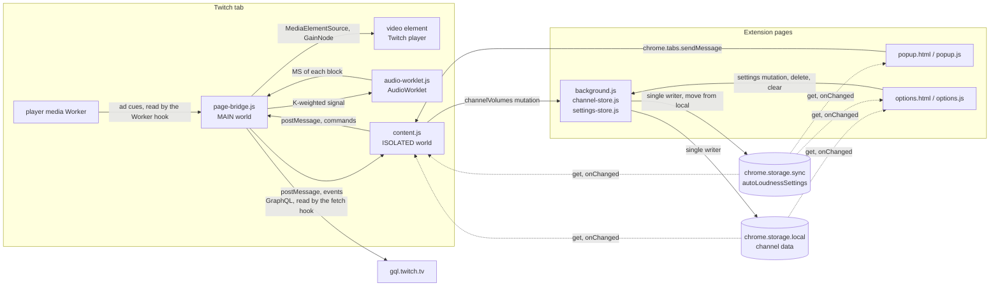

# 構成

> For the English version, see [architecture.md](architecture.md).

拡張機能の各スクリプトが何をするか、どこで動くか、ほかのスクリプトと何をやりとりするかを書く。そのあとに、i18n (表示する言葉の切り替え)、視聴者の使い方の流れ、スクリーンショットの生成器を書く。設計の理由は [design.ja.md](design.ja.md) に、コードを触るときのメモは [development.ja.md](development.ja.md) に、全ファイルの表は `AGENTS.md` の「File overview」にある。

## page-bridge.js (MAIN world の content script、document_start)

- AudioContext / MediaElementSource / GainNode を持つ
- 計測は `core/loudness.js` のメーター ([channel-volume-core](https://github.com/semnil/channel-volume-core/blob/main/docs/shared-files.ja.md#loudness)) が行う。このスクリプトより先に、同じ world に読み込まれる。メーターが持つもの: context のサンプルレートに合わせた K 特性の IIRFilter (プリフィルターのハイシェルフ + RLB ハイパス、BS.1770-4)、100ms のブロックごとに MS を送る AudioWorklet (k-mean-square)、Momentary (4 ブロック)、Short-term (30 ブロック)、ゲート付きの Integrated とその窓の数。Integrated は、種別ごとに保存した LUFS と、それを測ったときの窓の数を種にして始める (下限 300 窓 = 30 秒、上限 1800 窓 = 3 分)。bridge がメーターに渡すもの:
  - 届いたブロックを video.volume の 2 乗で割ったもの (`normalizeForVolume`)。音量 1.0 のときの値にそろえる
  - ブロックを足さずに保つかどうかを決める CM のゲート、下に書く境界のスキップ、CM の始まりで直近の窓を取り消す巻き戻し、`resetMeasurement` の種、別の要素をつないだときの新しいゲーティング窓
- 境界のスキップ: CM が終わったあと、または音量が変わったあと、ゲーティング窓が境界を抜けるまでの 4 窓を Integrated から外す
- CM のゲート: 再生位置が cue の `startTime` 以上で `endTime` より前の間は、Integrated に何も足さない。cue を 1 つも受け取っていない間は、ゲートは DOM の CM 表示に従う
- CM の始まりの巻き戻し: cue が届いたときの経過時間 (再生位置 − cue の `startTime`) から、1 + 経過時間/0.1 窓を取り消す。cue が無く DOM の CM 表示だけのときは 5 窓 (最後のリセットより後に足した窓だけが対象。リングバッファがあふれた後でも行う)。境界のスキップが足さなかった窓の分は、その数から引く
- 計測の epoch: resetMeasurement と一緒に受け取った番号を持ち、その後の lufs の通知に付ける
- つなぐためのループ (scheduleAttach): video を 1 秒おきに探し直す。DOM から外れた video を見つけたら、つなぎを外して、ループを自分でやり直す
- つなげなかった要素を覚えておき、その要素がページに残っている間は attached に takenElsewhere を付ける
- buildMeasurementChain: メーターのつなぎ (`buildChain`)。attach のときにつなぐ (attach は worklet の読み込みが決着した後に走る)
- 要素を取るのは、Web Audio がその音を運べるときだけ。`srcObject` があるとき、ページ自身のオリジンのとき、`crossorigin` 属性があるとき。別のオリジンが CORS モードの外で配るメディア (Twitch のクリップ) はプレイヤーに任せ、`attach-failed` / `cross-origin` として知らせる
- fetch のフック (GraphQL だけ):
  - gql.twitch.tv → 応答から、ユーザーの login と一緒に user.id を、動画の id と一緒に video.owner.id を取り出す。応答が動画の id を挙げていない動画の持ち主は取らない
- unhandledrejection のリスナー: 既定の動作を止めるのは、Live・VOD・クリップのページで fetch のフックを通して出した要求が失敗したときの `TypeError: Failed to fetch` だけ
- Worker のフック: メッセージのリスナーを足すためだけに `Worker` を包む。worker は、ページが渡した引数のままで作る
  - プレイヤーが送る CM の cue を読む (`rollType` と、メディアの時刻で表した `startTime` / `endTime`)。受け取るのは、その区間 (始まりの 1 秒前から終わりまで) に再生位置が入っている cue だけ (CM の間は 2 つ目のプレイヤーが、別の時間軸で自分の CM の cue を出す)
  - cue が CM 枠の最後の広告だと言っていない限り (`podPosition` < `podCount` - 1、または値が読めない)、次の cue を待って CM を 0.4 秒開いたままにする
- CM 要素: 本編の要素が止まったまま別の要素が鳴っているとき (VOD の CM で観測した)、そちらにも GainNode を入れ、baseline * adGainOffset * (本編の音量 / その要素の音量) をかける
- CM の間、GainNode には baseline * adGainOffset (dB → ゲイン) をかける
- context の状態 (`audio-context`) を知らせる。context を作ったとき、状態が変わるたび、`resume` への答えとして。まだ context が無いところへ `resume` が来たら、context を作る
- postMessage (`__twitch_channel_volume__`) → content.js

## content.js (ISOLATED world の content script、document_idle)

- postMessage のリスナー: page-bridge.js から LUFS / 持ち主 / CM の状態 / つないだ結果を受け取る
- つないだ結果の状態: attach-failed は audioUnavailable と原因 (element-taken / audio-context / cross-origin) を立てる。attached は、takenElsewhere (ほかに取られた要素がまだページにある) と measuring (計測のつなぎがあるか) から audioUnavailable / measurementUnavailable を決める。bridge が読み直されたら状態を消し、attach をもう一度送る
- audioUnavailable の間は、lufs の通知を捨てる (別の要素の値は保存せず、Auto もかけない)。ゲインのオーバーレイを外し、手動ゲイン・Auto の設定・計測のリセットの変更を断る。audioUnavailable が解けた瞬間に計測をリセットする (bridge の窓には、別の要素のブロックがまだ残っている)
- resume のための操作: document の `click` と `keydown` を capture フェーズで受け、bridge が context は動いていると知らせるまで `resume` を頼む。動かなくなったら、また受け始める
- URL の分類 (classifyTwitchUrl): live / vod / clip / none
- チャンネルの解決:
  - live: URL の login 名 (`login:<name>`) / GraphQL の user.id が分かったら数字の ID
  - vod: GraphQL の owner.id (`<numeric>`) / 分からないときは `vod-owner:<videoId>`
  - clip: なし。クリップは、チャンネルも、保存した値も、持ち主の問い合わせも持たない
- 持ち主の応答を、今の login / videoId と照らし合わせ、仮 ID の設定を数字の ID へまとめる。ページの MAIN world のスクリプトは、bridge と同じように持ち主のイベントを送れる。そのためイベントは、`userId` が数字だけの文字列で、`contentId` が文字列のときにだけチャンネルを指し (`ownerMatchesTwitchContent`)、`login` / `displayName` は文字列のときだけ受け取る
- 保存したゲインを自動でかける (Live/VOD の種別ごとに別々に持つ)
- LUFS 自動追従: チャンネル × Live/VOD ごとの Auto の設定がオンの間、Target LUFS までの差から基準ゲインを計算し直す。1 秒に 1 回より多くは行わない (`AUTO_FOLLOW_INTERVAL_MS`)
  - Auto は、Integrated の値が求めるゲイン (`calcGain(integrated)`) を、下げるときも上げるときもすぐにかける。Auto のために保存するのも同じゲイン ([design.ja.md](design.ja.md) の「Auto のゲインは Integrated の値が求めるゲイン」)
- ゲインのオーバーレイ: `.volume-slider__slider-container` の**次のきょうだい**として span を入れる。ミュートを包む要素とスライダーの入れ物は、プレイヤーの操作部の中で flex の行に並ぶきょうだいなので、span はスライダーの入れ物のすぐ右に来る。見える・見えないは、親の `[data-a-target="player-controls"][data-a-visible]` の切り替えにそのまま従う (プレイヤーの操作部の中に埋め込んであるため)。ゲイン ≠ 1.0 で、音声のつなぎがある間だけ出す。表示は `%` に固定で、displayUnit には従わない。ルートが変わるとプレイヤーが作り直されるので、作ってある span を新しいスライダーの入れ物の横に入れる。これで、入れ替えられた古い入れ物からは外れる
- 計測は、起動のとき、SPA 遷移のとき、持ち主の ID が分かったときに、保存した LUFS を種にする。種を入れ直す必要があるかは、持ち主のユーザー ID と種別を、計測が最後に種を入れた相手と比べて決める。種を送るのは、勝った行を読んだ読み取りで、起動と遷移のときも同じ。保存した窓の数 (`lastLufsWindows`) も一緒に渡し、bridge はそれを種の重みに使う。窓の数を持たない保存値 (拡張機能の更新より前のもの) は、bridge の下限の重みになる
- 計測のリセットは、送る前に epoch の番号を進める。古い epoch の lufs の通知は捨てる
- SPA 遷移では、先に `mediaChanged` を送り、bridge とそろえるために `requestedAdActive` を消す。**最後に DOM を読んだとき**にあった CM 表示の要素を控えておき、その要素そのものは新しいメディアの CM 表示として扱わない (あとから現れる別の要素は新しいメディアのもの。控えは、その要素が DOM から外れたら捨てる)。遷移を処理した直後に DOM を読み直すので、同じまとまりで届いた CM 表示はその場で知らせる (計測のリセットは 1 つのメディアの中でも起きるので、cue を捨てるのはこの経路だけ)
- DOM での CM の検出 (`[data-a-target="video-ad-countdown"]` / `[data-test-selector="ad-banner-default-text"]`) が CM ゲインを動かすのは、cue を 1 つも受け取っていないメディアでだけ
- SPA 遷移: history.pushState/replaceState のフック + popstate + MutationObserver
- channelVolumes の更新は Service Worker のただ 1 本の列に任せ、タブの間は onChanged でそろえる
- 設定は、起動のときに [`readSettings`](https://github.com/semnil/channel-volume-core/blob/main/docs/shared-files.ja.md#settings) で 1 回読む。onChanged は、`autoLoudnessSettings` を `sync` の領域からだけ、チャンネルのキーを `local` の領域からだけ受け取る
- popup からの chrome.tabs.sendMessage を、`getState` / `previewGain` (かけるが保存しないゲイン。スライダーの上でキーかポインターを押している間に送られ、押し続けている間は 1000 ms ごとにまた送られる。操作を終える `setGain` が届くか、何も届かないまま 2000 ms たつまで、content は storage の変化や Auto が決めたゲインをその上にかけない。プレビューが保存なしで終わったとき、または保存が断られたときは、保存してあるゲインに戻す) / `setGain` / `setAutoApplyLoudness` / `resetMeasurement` / `resume` として扱う。知らない cmd には `unknown command` と答える (options は、削除と全消去を Service Worker へ直接送る)
- Storage
  - `autoLoudnessSettings: { targetLufs, adGainDb, displayUnit, showGainOverlay, autoApplyLoudnessLiveDefault, autoApplyLoudnessVodDefault }` — `chrome.storage.sync` に置く。下のほかのキーは、すべて `chrome.storage.local` に置く
  - `channelVolumes: { [channelId]: { name, login, gainLive, gainVod, autoGainLive, autoGainVod, autoApplyLoudnessLive, autoApplyLoudnessVod, url, lastLufs, lastLufsRef, lastLufsWindows, lastLufsClearedAt, autoGainRef, lastMeasuredAt, __fieldVersions } }`
  - `channelVolumeAliases: { [loginOrContentProvisionalId]: canonicalOwnerId }`
  - channelVolumeSequence: 項目を更新した順番を表す、消えないカウンター

## audio-worklet.js (ページのコンテキスト、page-bridge.js が読み込む。channel-volume-core のもの)

- KMeanSquareProcessor: blockSec (既定 0.1) ごとに、L²+R² の平均を port.postMessage で送る。共有のファイルで、することは channel-volume-core の [docs/shared-files.ja.md](https://github.com/semnil/channel-volume-core/blob/main/docs/shared-files.ja.md#worklet) にある

## channel-store.js (service worker の補助)

- channelVolumes を「読む・変える・書く」の一連を、ただ 1 本の列で順に行う
- ゲイン / Auto / LUFS / 削除 / 全消去の変更を検査して反映する
- 行を書く・まとめるのは、Twitch のユーザー ID か、仮の `login:` / `vod-owner:` の ID の下でだけ (`assertWritableChannelId`。それ以外は `invalid-mutation` として断る)。どのオブジェクトも受け継いでいるキー (`__proto__` など) は、そのどれでもない。`deleteChannel` はどのキーでも受け取る。以前の版の行は別のキーを持ちうるため。store が作る行の名前は、送り手の名前が文字列ならその名前、そうでなければ id にする (`fallbackRowName`)。送り手が渡した名前は、[`applyEntryName`](https://github.com/semnil/channel-volume-core/blob/main/docs/shared-files.ja.md#stored-map) を通って行に入る
- 計測のリセットは、対象の種別の lastLufs と、それを説明する lastLufsRef / lastLufsWindows だけを消す (autoGainRef は残す)。消したことを、更新の番号を持つ状態として残すので、ID をまとめた後も消えたままになる。消した時刻も残す (`lastLufsClearedAt[kind]`。まとめるときは遅い方)。計測の始まり (`since`、必須) がその時刻より前の `saveMeasurement` は何も書かない。そのため、リセットが届いたときにすでに送られていた保存が、古い値を戻すことはない。タブは、自分の計測も空にする。行を読んで、その計測が始まった後にその種別が消されていると分かったとき (別のタブのリセット。読んだ時点で行が何を持っていても同じ) と、前に読んだ行にあった値が無くなっていたとき (行が削除された) がこれに当たる
- 仮 ID から数字の持ち主 ID への別名を保存し、どの変更でも正規の ID を引く。`clip-owner:<slug>` の別名は、書くたびに消す。クリップには何も残さないので、指す先が無い (別名をたどるときは、仮 ID の側の name / login / url は反映しない)。書き込みで、別の id へ移らずに消えた行 (削除したチャンネル、クリップだけが中身だった行) は、その行へ直接または別の別名を通ってたどり着く別名を、すべて一緒に消す。チャンネルを全消去すると、別名もすべて消える
- login が同じ Live の行と数字の持ち主の行をまとめ、URL をチャンネルの URL にそろえる
- 仮 ID と確定した ID を、項目ごとの消えない更新の番号でまとめる

## settings-store.js (service worker の補助)

- autoLoudnessSettings の項目ごとの変更を検査する
- 拡張機能がもう持っていない種別のために残っていた設定 (`autoApplyLoudnessClipDefault`) を、書く内容から落とす。項目の変更でも、移し替えでも同じ
- 「読む・変える・書く」の一連を、ただ 1 本の列で順に行い、複数の設定タブが互いに上書きするのを防ぐ。読むのは `readSettings` を通し、書くのは `chrome.storage.sync` にだけ
- 以前の版が local に置いた設定を 1 回だけ移す処理 (core/common.js の `moveSettingsToSync`。拡張機能がもう持っていない項目は `withoutRemovedSettings` が落とす) を、同じ列の上で走らせる (`writeSettings.moveToSync()`)。background.js が、worker の起動のたびにトップレベルでこれを頼む

## core/common.js (channel-volume-core のもの。popup/options と content.js では utils.js より先に、worker では store より先に読み込む)

共有のコード。各部分がすることは channel-volume-core の [docs/shared-files.ja.md](https://github.com/semnil/channel-volume-core/blob/main/docs/shared-files.ja.md#shared-code) にある。この拡張機能がそれに何を渡し、どう使うかは、それを呼ぶファイルの節に書く。

- 設定を読むものは、すべて `readSettings` を通す。設定の書き手の「読む・変える・書く」も同じ。ページと content.js は、`chrome.storage` を自分で渡す
- channel-store.js は、`createStoredMapWriter` を使わず、channelVolumes の書き手を自分で持つ。この書き手は、別名と更新の通し番号も持つ

## core/loudness.js (channel-volume-core のもの。MAIN world で page-bridge.js より先に読み込む)

共有の計測。K 特性、worklet を組み込むつなぎ、メーター。各部分がすることは channel-volume-core の [docs/shared-files.ja.md](https://github.com/semnil/channel-volume-core/blob/main/docs/shared-files.ja.md#loudness) にある。bridge がそれに渡すものは page-bridge.js の節に書く。ページの world に宣言する名前は `channelVolumeLoudness` の 1 つだけで、これは凍結したオブジェクト。bridge は起動のときに、そこから各部分を読む。

## utils.js (共有。popup/options + content.js + test.js。MAIN world には読み込まれないので、page-bridge.js は定数を自分で持つ)

- 定数: SETTINGS_MUTATION_MESSAGE, CHANNEL_VOLUMES_KEY, CHANNEL_ALIASES_KEY, CHANNEL_SEQUENCE_KEY, DEFAULT_AD_GAIN_DB, DEFAULT_AUTO_APPLY_LOUDNESS, LUFS_REFERENCE_VOLUME_1
- ゲインの道具: dbToGain, calcGain, suggestedGain, resolveAutoApplySetting, resolvePreferredGain
- URL の分類: classifyTwitchUrl (TWITCH_RESERVED_PATHS は除く)

## popup.html / popup.js

- チャンネル名 + 種別のバッジ (Live/VOD) + CM 検出中のバッジ
- チャンネルの行のアイコンボタン (36×36) は、今の種別の保存した LUFS と、走っている計測を消す。ラベルは見えないようにして、読み上げ用の名前に使う。マウスを乗せたときの文は title に入れる
- チャンネル名は行の幅で切るので、全文は title に入れる
- 3 枚のカードを 1 行に並べたグリッド: Integrated LUFS / Suggested gain / Current gain (レイアウトは姉妹の拡張機能と共通)
  - Suggested gain は、目標までの差から計算する (ゲートを通った値がまだ無い間は 100%)
  - Suggested / Current の表示は displayUnit (% / dB) に従う
  - setCardValue は、単位 (LUFS / dB / %) を `` に分け、小さく灰色で出す
- Auto がオフのとき、適用ボタンは Suggested gain を displayUnit で出す。Auto がオンのとき、Current と Manual Volume は、今かかっているゲインに合わせる
- Auto がオンで、Integrated の値がまだ取れていない間は、Fallback のバッジを出す
- 今見ている種別についての、チャンネルごとの「LUFS 自動追従」の切り替え
- Auto の保存に失敗したら、その言語のエラーを出し、最新の状態を読み直す
- Auto の保存が進んでいる間は、Apply / Manual の操作を無効にする。content.js も手動ゲインの変更を断る
- クリップでは、状態の行が画面全体の代わりになる (Twitch でないタブや、読み直しが要るページに答えるのと同じ場所)。mainArea を隠し、その 1 行が「クリップの音量はプレイヤーに任せる」と伝える。クリップを離れると画面が戻る
- audioUnavailable / measurementUnavailable の間は、理由と直し方をチャンネルの行の下に出す (文は 4 つで、原因ごとに 1 つ: 要素がほかに取られている / メディアが別のオリジンから来ている / AudioContext を作れなかった / 計測の経路だけが使えない) (チャンネルが決まっていないページでは何も出さない)。audioUnavailable の間は、Apply / Manual / Auto の切り替え / 計測のリセットを無効にし、3 枚のカードは「不明」を出す。ゲインの保存の失敗はこの知らせより優先し、ヒントの行は空のままにする
- Manual のスライダー (スライダー自体は 0–600%、表示する値は displayUnit に従う) + 6 つのプリセット (0/50/100/200/400/MAX)。Auto の切り替えや計測のリセットと同じチャンネルに結び付ける。ゲインはチャンネルに対して保存するもので、content.js はチャンネルなしで送られた setGain を断る
- 起動のときに SETTINGS_KEY を `readSettings` で読み、options で単位を変えたときは storage.onChanged ですぐに反応する。キーは `sync` の領域からだけ受け取る

## options.html / options.js

- Target LUFS のスライダー (-30 から -6 LUFS、既定 -18)
- 全チャンネルに対する LUFS 自動追従の既定値 (Live / VOD で別、既定は OFF)
- CM ゲインのスライダー (-24 から +6 dB、既定 -6 dB)
- 表示の単位 (% / dB)。すでに使っている単位は書き直さない
- ゲインのオーバーレイのオン・オフの切り替え (既定は ON)
- Saved Channels の表 (Live / VOD の 2 列。Auto がオンの間は、最後に保存した計測値が求める Auto のゲイン。保存が無いところは `Auto (—)`。削除できる)。並び順は、各行を表示する名前 (`rowLabel`) の順。保存した名前が文字列でないときは、チャンネルの id を出す
- 設定の操作部と削除 (全消去、行の ×) は、最初の設定の読み込みが終わるまで、すべて無効にする
- 変わった項目だけを、Service Worker の設定の変更として保存する。storage.onChanged でそろえる。設定は `sync` の領域から、チャンネルの一覧は `local` の領域から受け取る。Target LUFS か CM ゲインのスライダーの上でキーかポインターを押している間に届いた設定の変化は、受け取るが、そのスライダーとラベルには出さない (`settingsSliderHeld`)。操作の終わりが自分の値を送るか、何も送らないときはその設定を描く ([`holdSettingsSlider`](https://github.com/semnil/channel-volume-core/blob/main/docs/shared-files.ja.md#sliders))
- 最初の読み込みは、設定 (`readSettings`) と `channelVolumes` (local) を一緒に読む。どちらかの読み取りが失敗すれば、読み込みは失敗になる

## i18n

- `_locales/en/messages.json` — 英語。`default_locale` で、ここにカタログが無いブラウザの言語には英語で答える
- `_locales/ja/messages.json` — 日本語
- manifest の name/description は `__MSG_` の参照を使う
- popup/options の UI の文字列は、`data-i18n` 属性 + `chrome.i18n.getMessage` を使い、`applyI18n` (core/common.js) が入れる。マークアップは各要素のキーを持ち、カタログにキーが無いときは、そのキーがそのまま出る
- popup/options は、`<html lang>` を `pageLanguage` のメッセージから入れる。各カタログは、このメッセージに自分のロケールで答える。そのためページは、Chrome が中身を入れるのに使ったカタログの言語を名乗る。マークアップの `lang` は `default_locale` のもの

## 使い方の流れ

1. 配信か VOD を開く → popup で、今の種別の「LUFS 自動追従」をオンにする
2. Integrated LUFS の値が更新されるたびに、ゲインは Target LUFS に合うゲインへ、下げるときも上げるときもすぐに、多くても 1 秒に 1 回追従する
3. 「測定値をリセット」は、今の種別の保存した LUFS を消し、走っている計測をゼロからやり直す。やり直した後の値は、それまでと同じように保存する
4. Auto がオフの種別では、「チャンネルに適用」か Manual Volume が、それまでと同じようにゲインを保存する
5. CM の間は、CM Gain (既定 -6 dB) を上乗せする
6. Manual Volume のスライダーは、どのゲインにも設定できる

## スクリーンショットの生成器とその出力

| ファイル | 役割 |
|------|------|
| `gen_screenshots.py` | スクリーンショットの生成 (PIL で直接描く。640×400、ja/en → `docs/screenshots/`)。描く文言は、ここに書かずに `_locales/<lang>/messages.json` から読む。読めないカタログや、スクリーンショットが描くメッセージが無いカタログは、足りないものを名指しして exit 1 にする。設定の行は `SETTING_ROWS` に宣言してあり、描画はそれをたどる。`test.js` は、それを `options.html` が並べる行と比べる (数、順番、各行が出すメッセージ、操作部の種類とその個数)。宣言した操作部の名前で描く関数を選ぶので、描画が持っていない名前は、その行を名指しして exit 1 にする。シートの高さは行の数から決まり、何かを描く前に 640x400 のキャンバスと照らし合わせる。キャンバスからはみ出た分を切り取る仕組みが無いため。`--check` は何も書かず、次の順に見る。追跡しているファイルまでのパスの各部分と、画像が通常のファイルかどうか → PNG の構造 (シグネチャ、チャンク、IDAT の zlib ストリーム) → チャンクの順番 → IHDR の寸法 → IDAT の外のバイト → RGBA のピクセル (デコーダーは最後)。違いがあれば exit 1、描けない環境は exit 3。`--out <dir>` は出力先を置き換える。知らない引数、`--check` と `--out` を一緒に渡したとき (順番はどちらでも)、`--out` の繰り返し、フラグの形をした値、ディレクトリにできない出力先 (すでにあるディレクトリでないもの、先の無いリンク、ディレクトリでない親) は、exit 2 で断る。引数の間違いには、Pillow や書体の読み込みの失敗より先に答える (import と書体の解決そのものはモジュールの読み込みのときに起きる。失敗は持ち越して、引数の解析の後に exit 3 にする)。`--chek` で上書きしないようにするため。追跡しているファイルまでのパスのどこかが本物のディレクトリでなければ、描画も `--check` も何もせず、exit 1 で終わる。ファイルシステムに断られたときもトレースバックにはしない。`--out` で名指しした出力先は exit 2 (それが追跡している場所であっても)、引数なしの追跡している場所は exit 1。断られた場所は、それぞれ別に名指しする (バックアップを読めなかった / 作業用のディレクトリに描けなかった / 出力先に書けなかった) |
| `docs/screenshots/` | `gen_screenshots.py` の出力。README とストアの掲載に使う (拡張機能には同梱しない)。追跡しているものは、`tools/fonts/` の M PLUS 1p の書体で描いてある。生成器はその 2 つの書体を使い、無ければ止まる (別の書体で描くと、6 枚の画像がすべて入れ替わってしまう)。6 枚は、作業用のディレクトリで最後まで描いてから移す。移動が 1 つでも失敗したら、追跡している名前を元の状態 (通常のファイル / リンク / 無し) まで全部戻す。そのため、描いている途中や入れ替えの途中で止まっても、追跡しているファイルは元のままになる。描いた名前がディレクトリを指すリンクのときは、移動するとその中に入ってしまうので、入れ替えを先に断る。通常のファイルはバックアップへコピーし、リンクはリンクとして置く (置けないものが 1 つでもあれば、何も移さず、両方の端 (画像とバックアップ) を名指しする。copy2 は読みと書きを 1 回の呼び出しで行い、呼び出した側にはどちらの端が断ったのか分からないため)。元に戻すこと自体が断られたときは、戻せなかった名前と、その前にそこにあったもの (リンクの先も含む) を伝える。前に何かがあった名前がまだ残っていれば、バックアップを残して場所を名指しする (前に何も無かった名前は消す)。片付けられなかったバックアップがあるときは exit 0 にしない (exit 0 が言うのは、この実行がバックアップを残さなかったことだけで、すでにあった PNG でないものについては何も言わない。`--check` は .png だけを数える)。CI は `--check` で描き直して、ピクセルを比べる |
