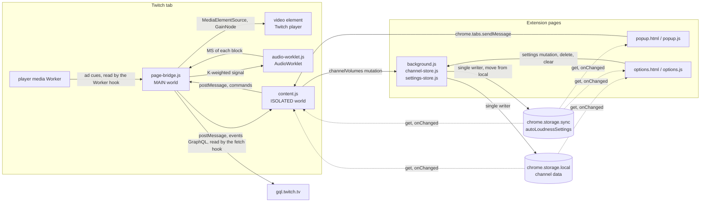

# Architecture

> 日本語版は [architecture.ja.md](architecture.ja.md) を参照してください.

What each script of the extension does, where it runs and what it exchanges with the others, followed by the i18n, the viewer's workflow, and the screenshot generator. The reasons behind the design are in [design.md](design.md), the notes for working on the code in [development.md](development.md), and the table of every file in `AGENTS.md`, "File overview".

## page-bridge.js (MAIN world content script, document_start)

- Owns the AudioContext / MediaElementSource / GainNode
- The measurement is the meter of `core/loudness.js` ([channel-volume-core](https://github.com/semnil/channel-volume-core/blob/main/docs/shared-files.md#loudness)), loaded ahead of this script in the same world: the K-weighting IIRFilters (pre-filter high-shelf + RLB high-pass, BS.1770-4) for the context's rate, the AudioWorklet (k-mean-square) that posts the MS of each 100ms block, Momentary (4 blocks), Short-term (30 blocks) and the gated Integrated with its window count, seeded from the stored per-kind LUFS and the window count it was measured over (floor 300 windows = 30 seconds, cap 1800 windows = 3 minutes). What the bridge gives it:
  - Each block divided by video.volume squared on arrival (`normalizeForVolume`), normalising it to volume 1.0
  - The ad gate as the block's hold, the boundary skips below, the ad-start rollback's removal of recent windows, `resetMeasurement`'s seed, and a fresh gating window when another element is attached
- Boundary skip: after an ad ends or the volume changes, the 4 windows it takes for the gating window to clear the boundary are excluded from Integrated
- Ad gate: nothing is added to Integrated while the playback position is at or past the cue's `startTime` and before its `endTime`. While no cue has been received at all, the gate follows the DOM indicator instead
- Ad-start rollback: from the elapsed time when the cue arrives (playback position − the cue's `startTime`), 1 + elapsed/0.1 windows are withdrawn; with no cue and only the DOM indicator, 5 windows (windows added since the last reset only; done after the ring buffer has overflowed too). Windows the boundary skip never added are subtracted from that count
- Measurement epoch: the number received with resetMeasurement is held and stamped on later lufs notifications
- attach loop (scheduleAttach): retries for a video at 1s intervals. On detecting a video that left the DOM, it tears the chain down and restarts the loop itself
- Holds the element it could not attach to, and sets takenElsewhere on attached while that element remains in the page
- buildMeasurementChain: the meter's chain (`buildChain`), connected at attach time (attach runs after the worklet load has resolved)
- Takes an element only when Web Audio can carry its audio: a `srcObject`, the page's own origin, or a `crossorigin` attribute. Media another origin serves outside CORS mode (a Twitch clip) is left to the player and reported as `attach-failed` / `cross-origin`
- Fetch hook (GraphQL only):
  - gql.twitch.tv → extracts user.id with the user's login / video.owner.id with the video's id, both from the answer. A video owner whose answer names no video id is not taken
- unhandledrejection listener: prevents the default only for the `TypeError: Failed to fetch` that a request made through the fetch hook on a live, VOD or clip page failed with
- Worker hook: wraps `Worker` only to add a message listener. The worker is constructed with the arguments the page passed
  - Reads the ad cues the player posts (`rollType` and `startTime` / `endTime` in media time). Only a cue whose span (from 1 second before the start to the end) contains the playback position is accepted (during an ad a second player cues its own ads on another timeline)
  - Unless the cue says it is the last creative of the pod (`podPosition` < `podCount` - 1, or the value is unreadable), the ad is held open for 0.4 seconds waiting for the next cue
- Ad element: when the main element stays paused while another element sounds (observed on VOD ads), a GainNode is inserted there too, applying baseline * adGainOffset * (main volume / its volume)
- While an ad is active the GainNode applies baseline * adGainOffset (dB → gain)
- Reports the context's state (`audio-context`) when the context is built, whenever it changes, and as the answer to `resume`. A `resume` builds the context where there is none yet
- postMessage (`__twitch_channel_volume__`) → content.js

## content.js (ISOLATED world content script, document_idle)

- postMessage listener: receives LUFS / owner / ad state / attach results from page-bridge.js
- Attach-result state: attach-failed sets audioUnavailable and a cause (element-taken / audio-context / cross-origin); attached decides audioUnavailable / measurementUnavailable from takenElsewhere (an element held by someone else is still in the page) and measuring (whether a measurement chain exists). On a bridge reload the state is cleared and attach is sent again
- While audioUnavailable, lufs notifications are discarded (another element's reading is neither stored nor applied by Auto), the gain overlay is removed, and manual-gain, Auto-setting and measurement-reset mutations are refused. Measurement is reset the moment it clears (the bridge's windows still hold blocks from the other element)
- Resume gestures: `click` and `keydown` at the document, in the capture phase, ask the bridge for a `resume` until it reports the context running, and go back on if it ever stops running
- URL classification (classifyTwitchUrl): live / vod / clip / none
- Channel resolution:
  - live: the login name from the URL (`login:<name>`) / the numeric ID once GraphQL user.id resolves
  - vod: GraphQL owner.id (`<numeric>`) / fallback `vod-owner:<videoId>`
  - clip: none. A clip carries no channel, no stored value and no owner lookup
- Matches the owner response against the current login / videoId and merges the provisional ID's settings into the numeric ID. Any script in the page's MAIN world can post the owner event as well as the bridge can: it names a channel only with a `userId` that is a string of digits and a `contentId` that is text (`ownerMatchesTwitchContent`), and its `login` / `displayName` are taken only as text
- Automatic application of the stored gain (managed separately per Live/VOD kind)
- LUFS auto-follow: while the per-channel × Live/VOD Auto setting is on, the baseline gain is recomputed from the distance to Target LUFS, no more often than once a second (`AUTO_FOLLOW_INTERVAL_MS`)
  - Auto plays the gain the Integrated value asks for (`calcGain(integrated)`), lower or higher, at once. What is stored for Auto is the same gain (see [design.md](design.md), "An Auto gain is the one the Integrated value asks for")
- Gain overlay: a span is inserted as the **next sibling** of `.volume-slider__slider-container`. The mute wrapper and the slider container are siblings in a flex row inside the player controls, so the span sits directly to the right of the slider container. Visibility follows the parent `[data-a-target="player-controls"][data-a-visible]` toggle by itself (it is embedded inside the player controls). Shown only while gain ≠ 1.0 and an audio chain exists; the display is fixed to `%` and does not follow displayUnit. A route change rebuilds the player, and the span already made is inserted beside the new slider container, which moves it out of the one that was replaced
- Measurement is seeded from the stored LUFS at startup, on SPA navigation and also once the owner ID resolves. Whether a re-seed is needed is decided from the owner's user id and the kind against what the measurement was last seeded for, and the read of the row that wins sends it, startup and navigation included. The stored window count (`lastLufsWindows`) is passed with it and the bridge uses it as the seed's weight. A stored value with no window count (from before the extension update) is weighted at the bridge's floor
- A measurement reset advances the epoch number before it is sent, and lufs notifications from an older epoch are discarded
- On SPA navigation `mediaChanged` is sent first and `requestedAdActive` is cleared to stay aligned with the bridge. The ad-indicator element present **at the last DOM read** is noted, and that element itself is not treated as an indicator for the new media (a different element that appears belongs to the new media; the note is dropped once the element leaves the DOM). The DOM is re-read right after the navigation is handled, so an indicator that arrived in the same batch is reported there and then (a measurement reset also happens within one media, so only this path discards cues)
- DOM ad detection (`[data-a-target="video-ad-countdown"]` / `[data-test-selector="ad-banner-default-text"]`) drives the ad gain only on media that have received no cue at all
- SPA navigation: history.pushState/replaceState hook + popstate + MutationObserver
- channelVolumes updates are delegated to the Service Worker's single queue, with cross-tab sync through onChanged
- Settings are read once at startup through [`readSettings`](https://github.com/semnil/channel-volume-core/blob/main/docs/shared-files.md#settings). onChanged takes `autoLoudnessSettings` only from the `sync` area and the channel keys only from the `local` area
- Handles chrome.tabs.sendMessage from the popup as `getState` / `previewGain` (a gain applied and not saved, sent while a key or the pointer is held on the slider and again every 1000 ms while it stays held; until the `setGain` that ends the gesture arrives or 2000 ms pass with none, content applies no gain a storage change or Auto resolves over it, and puts back the stored gain where the preview ends with no save or a refused one) / `setGain` / `setAutoApplyLoudness` / `resetMeasurement` / `resume`, and answers an unknown cmd with `unknown command` (options sends delete and clear-all straight to the Service Worker)
- Storage
  - `autoLoudnessSettings: { targetLufs, adGainDb, displayUnit, showGainOverlay, autoApplyLoudnessLiveDefault, autoApplyLoudnessVodDefault }` — in `chrome.storage.sync`; every other key below is in `chrome.storage.local`
  - `channelVolumes: { [channelId]: { name, login, gainLive, gainVod, autoGainLive, autoGainVod, autoApplyLoudnessLive, autoApplyLoudnessVod, url, lastLufs, lastLufsRef, lastLufsWindows, lastLufsClearedAt, autoGainRef, lastMeasuredAt, __fieldVersions } }`
  - `channelVolumeAliases: { [loginOrContentProvisionalId]: canonicalOwnerId }`
  - channelVolumeSequence: persistent counter for the field update order

## audio-worklet.js (page context, loaded by page-bridge.js; from channel-volume-core)

- KMeanSquareProcessor: port.postMessage of the L²+R² average every blockSec (default 0.1). Shared; what it does is in channel-volume-core's [docs/shared-files.md](https://github.com/semnil/channel-volume-core/blob/main/docs/shared-files.md#worklet)

## channel-store.js (service worker helper)

- Serialises the read-modify-write of channelVolumes through a single queue
- Validates and applies gain / Auto / LUFS / delete / clear mutations
- Writes and merges a row only under a Twitch user id or a provisional `login:` / `vod-owner:` id (`assertWritableChannelId`, refused as `invalid-mutation`); a key every object inherits, `__proto__` among them, is none of them. `deleteChannel` takes any key, since an earlier version's rows can carry another. A row the store makes is named by the sender's name where that is text and by its id otherwise (`fallbackRowName`), and a name the sender gives reaches a row through [`applyEntryName`](https://github.com/semnil/channel-volume-core/blob/main/docs/shared-files.md#stored-map)
- A measurement reset deletes only the lastLufs of the target kind and the lastLufsRef / lastLufsWindows that describe it (autoGainRef stays), and keeps the deletion as a state carrying an update number, so it survives ID merging. It also keeps the time of the deletion (`lastLufsClearedAt[kind]`, the later one on a merge), and a `saveMeasurement` whose measurement began (`since`, required) before that time writes nothing, so a save already on its way when the reset lands does not bring the old value back. A tab empties its own measurement too where a read of the row shows the kind cleared after that measurement began (another tab's reset, whatever the row holds by the time it is read), or the value gone from the row it read before (the row deleted)
- Persists the alias from a provisional ID to the numeric owner ID and resolves the canonical ID in every mutation. A `clip-owner:<slug>` alias is removed on every write: nothing is kept for a clip for it to point at (name / login / url from the provisional side are not applied when the alias is forwarded). A row that a write leaves gone without moving it onto another id — a deleted channel, a row a clip was the whole of — takes every alias that leads to it, directly or through another alias, and clearing the channels removes them all
- Merges a Live row and a numeric owner row that share a login, and normalises the URL to the channel URL
- Merges provisional and confirmed IDs by per-field persistent update numbers

## settings-store.js (service worker helper)

- Validates per-field mutations of autoLoudnessSettings
- Drops a setting kept for a kind the extension no longer has (`autoApplyLoudnessClipDefault`) from what it writes, on a patch and on the move alike
- Serialises the read-modify-write through a single queue, preventing settings tabs from overwriting each other. It reads through `readSettings` and writes to `chrome.storage.sync` alone
- The one-time move of the settings an earlier version kept in local — `moveSettingsToSync` in core/common.js, with `withoutRemovedSettings` dropping the fields the extension no longer has — run on that same queue (`writeSettings.moveToSync()`), which background.js asks for at the top level on every worker start

## core/common.js (from channel-volume-core, loaded ahead of utils.js by popup/options and content.js, and ahead of the stores by the worker)

The shared code. What each part does is in channel-volume-core's [docs/shared-files.md](https://github.com/semnil/channel-volume-core/blob/main/docs/shared-files.md#shared-code); what this extension gives it, and how it uses it, is under the file that calls it.

- Every reader of the settings goes through `readSettings`, the settings writer's read-modify-write among them. The pages and content.js pass `chrome.storage` themselves
- channel-store.js keeps its own writer of channelVolumes, which also holds the aliases and the update sequence, rather than `createStoredMapWriter`

## core/loudness.js (from channel-volume-core, loaded ahead of page-bridge.js in the MAIN world)

The shared measurement: the K-weighting, the chain the worklet is built into and the meter. What each part does is in channel-volume-core's [docs/shared-files.md](https://github.com/semnil/channel-volume-core/blob/main/docs/shared-files.md#loudness); what the bridge gives it is under page-bridge.js. It declares the one name `channelVolumeLoudness` in the page's world, a frozen object the bridge reads its parts from as it starts.

## utils.js (shared, popup/options + content.js + test.js. It is not loaded in the MAIN world, so page-bridge.js carries its own constants)

- Constants: SETTINGS_MUTATION_MESSAGE, CHANNEL_VOLUMES_KEY, CHANNEL_ALIASES_KEY, CHANNEL_SEQUENCE_KEY, DEFAULT_AD_GAIN_DB, DEFAULT_AUTO_APPLY_LOUDNESS, LUFS_REFERENCE_VOLUME_1
- Gain utilities: dbToGain, calcGain, suggestedGain, resolveAutoApplySetting, resolvePreferredGain
- URL classification: classifyTwitchUrl (TWITCH_RESERVED_PATHS excluded)

## popup.html / popup.js

- Channel name + kind badge (Live/VOD) + ad-detected badge
- An icon button (36×36) on the channel row clears the stored LUFS for the current kind and the running measurement. Its label is visually hidden and used as the accessible name, with title for the hover text
- The channel name is truncated to the row width, so the full text is carried in title
- One-row grid of three cards: Integrated LUFS / Suggested gain / Current gain (layout shared with the sibling extensions)
  - Suggested gain is computed from the distance to the target (100% while no gated value exists)
  - The Suggested / Current display follows displayUnit (% / dB)
  - setCardValue splits the unit (LUFS / dB / %) into a `` shown small and grey
- With Auto off, the apply button shows the Suggested gain in displayUnit; with Auto on, Current and Manual Volume are synced to the gain in force
- While Auto is on and no Integrated value has been obtained yet, a Fallback badge is shown
- Per-channel "Auto-follow LUFS" toggle for the kind currently being watched
- A failed Auto save shows a localised error and re-fetches the latest state
- While an Auto save is in flight, Apply / Manual controls are disabled, and content.js refuses manual gain mutations as well
- On a clip the status line stands in for the whole screen (the same place that answers a non-Twitch tab and a page needing a reload): mainArea is hidden and the one line says a clip's volume is left to the player. Leaving the clip brings the screen back
- While audioUnavailable / measurementUnavailable, the reason and the remedy are shown under the channel row (four wordings, one per cause: the element is held elsewhere / the media comes from another origin / the AudioContext could not be created / the measurement path alone is unavailable) (nothing is shown on a page with no resolved channel). Under audioUnavailable, Apply / Manual / the Auto toggle / measurement reset are disabled and the three cards show unknown. A gain-save failure takes precedence over this notice, and the hint row is left empty
- Manual slider (the slider itself is 0–600%, the displayed value follows displayUnit) + 6 presets (0/50/100/200/400/MAX). Held to the same channel the Auto toggle and the measurement reset are held to: the gain is saved against a channel, and content.js refuses a setGain sent without one
- Loads SETTINGS_KEY at startup through `readSettings` and reacts immediately to a unit change in options through storage.onChanged, taking the key from the `sync` area alone

## options.html / options.js

- Target LUFS slider (-30 to -6 LUFS, default -18)
- Default LUFS auto-follow for all channels (separate for Live / VOD, default OFF)
- Ad gain slider (-24 to +6 dB, default -6 dB)
- Display unit (% / dB). The unit already in use is not written again
- Gain overlay on/off toggle (default ON)
- Saved Channels table (two Live / VOD columns, the Auto gain the last stored measurement asks for while Auto is on, or `Auto (—)` where none is stored, deletable), in the order of what each row is shown under (`rowLabel`). A stored name that is not text is shown as the channel id
- Every settings control and deletion (clear all, the row ×) is disabled until the initial settings load completes
- Saves only the item that changed through the Service Worker's settings mutation, synced through storage.onChanged: the settings from the `sync` area, the channel list from the `local` area. A settings change that arrives while a key or the pointer is held on the Target LUFS or Ad gain slider is taken but left off that slider and its label (`settingsSliderHeld`); the gesture's end sends its own value, or draws the setting where it sends nothing ([`holdSettingsSlider`](https://github.com/semnil/channel-volume-core/blob/main/docs/shared-files.md#sliders))
- The initial load reads the settings (`readSettings`) and `channelVolumes` (local) together, and either read failing fails the load

## i18n

- `_locales/en/messages.json` — English, the `default_locale`: a browser language with no catalog here is answered in English
- `_locales/ja/messages.json` — Japanese
- The manifest's name/description use `__MSG_` references
- The popup/options UI strings use the `data-i18n` attribute + `chrome.i18n.getMessage`, applied by `applyI18n` (core/common.js). The markup holds each element's key, which is also what a key the catalog lacks shows
- popup/options set `<html lang>` from the `pageLanguage` message, which each catalog answers with its own locale, so the page declares the language of the catalog Chrome filled it from. The markup's `lang` is `default_locale`'s

## User workflow

1. Open a stream or a VOD → turn on "Auto-follow LUFS" for the current kind in the popup
2. Each time the Integrated LUFS reading updates, the gain follows the one that matches Target LUFS, lower or higher, at once and at most once a second
3. "Reset measurement" deletes the stored LUFS for the current kind and restarts the running measurement from zero. Readings taken after the restart are stored as before
4. For a kind with Auto off, "Apply to channel" or Manual Volume stores the gain as before
5. During an ad break the Ad gain (default -6 dB) is applied on top
6. The Manual Volume slider can set any gain

## The screenshot generator and its output

| File | Role |
|------|------|
| `gen_screenshots.py` | Screenshot generation (drawn directly with PIL, 640×400 ja/en → `docs/screenshots/`). The wording it draws is read from `_locales/<lang>/messages.json` rather than written out here — a catalog it cannot read, or one with no message a screenshot draws, is exit 1 naming what is missing. The settings rows are declared in `SETTING_ROWS`, which the drawing walks and `test.js` compares with the rows `options.html` lays out — count, order, the message each shows, and the control with how many of it; the declared control name picks the painter, so one the drawing has not got is exit 1 naming the row. The sheet's height comes from the row count and is checked against the 640x400 canvas before anything is drawn, because nothing clips to it. `--check` writes nothing and looks, in order, at each component of the path to the tracked file and whether the image is a regular file → PNG structure (signature, chunks, the IDAT zlib stream) → chunk order → IHDR dimensions → the bytes outside IDAT → RGBA pixels (the decoder comes last). A difference is exit 1, an environment that cannot draw is exit 3. `--out <dir>` replaces the destination. An unknown argument, `--check` and `--out` given together (in either order), a repeated `--out`, a value shaped like a flag, and a destination that cannot become a directory (an existing non-directory, a link with no target, a non-directory parent) are refused with exit 2. An argument mistake is answered before a Pillow or typeface load failure (the import and the typeface resolution themselves happen at module load; the failure is carried forward and exits 3 after argument parsing) so that `--chek` does not overwrite. If any component of the path to the tracked file is not a real directory, neither drawing nor `--check` does anything and it exits 1. A refusal from the filesystem is not a traceback either — a destination named with `--out` is exit 2 (even when it is the tracked location), and the tracked location with no argument is exit 1. Each place that refused is named separately (the backup could not be read / the working directory could not be drawn into / the destination could not be written) |
| `docs/screenshots/` | Output of `gen_screenshots.py`. Used by the README and by the store listing (not bundled into the extension). What is tracked is drawn with the M PLUS 1p faces in `tools/fonts/`. The generator uses those two faces and stops when they are absent (drawing with a different face would replace every one of the six images). The six are drawn to completion in a working directory before being moved, and if one move fails the tracked names are restored to what they were (regular file / link / absent) all the way back, so a stop during drawing or during replacement leaves the tracked files as they were. When the drawn name is a link pointing at a directory, the move would land inside it, so the replacement is refused first. Regular files are copied into the backup and links are placed as links (if one cannot be placed, nothing is moved and the two ends are named — the image and the backup — since copy2 is a single call that reads and writes and the caller cannot tell which end refused). When the restore itself is refused, the name that could not be restored and what was there before it (including a link's target) are stated, and if a name that had something before still exists the backup is kept and its location named (a name that had nothing before is deleted). A backup that could not be cleaned up does not exit 0 (exit 0 says only that this run left no backup behind, and says nothing about a non-PNG that was already there — `--check` counts only .png). CI redraws with `--check` and compares pixels |
