# ゲインの変化とチャンネルごとの保存

> For the English version, see [gain-change-and-save.md](gain-change-and-save.md).

この文書は、このリポジトリのコードをたどって、出来事 (イベント) ごとに 2 つの問いに答える。1 つ目は「Twitch のプレイヤーにかかるゲインが変わるか」、2 つ目は「チャンネルごとの値が `chrome.storage.local` に書き込まれるか」。ゲインとは、音の大きさを何倍にするかを表す値で、1.0 (100%) がそのままの大きさになる。場面ごとにシーケンス図 (誰が誰に何を送るかを時間の順に並べた図) と、図のもとにした関数を載せる。2 つの答えを並べた表は [イベントのまとめ](#イベントのまとめ) にある。これらの道筋が頼っていて、コードだけでは決まらない Chrome と Twitch の挙動は、測った結果を [測って確かめたブラウザとサイトの挙動](#測って確かめたブラウザとサイトの挙動) に挙げた。

## 全体像

### 登場するもの

| 登場するもの | ファイル | 動く場所 | ここでの役目 |
|---|---|---|---|
| popup | `popup.js` | 拡張機能のポップアップ (ツールバーのボタンで開く小さな画面) | 操作 (ゲイン、Auto、測定値のリセット) を、開いているタブの content script へ送る。`getState` を `DISPLAY_UPDATE_INTERVAL_MS` (1000 ms) ごとに読む。storage へは何も書かない |
| options | `options.js` | 拡張機能の設定ページ | 設定の変更と、チャンネルの `normalizeChannels` / `deleteChannel` / `clearChannels` を Service Worker へ送る |
| content | `content.js` | Twitch のタブ、ISOLATED world | 基準ゲイン (`currentGain`) を決めて bridge へ送り、チャンネルごとの変更を Service Worker へ送る |
| bridge | `page-bridge.js` | Twitch のタブ、MAIN world | `AudioContext`・出力の `GainNode`・LUFS の計測を持ち、ノードを実際にかかるゲインへ動かす |
| worklet | `audio-worklet.js` | AudioWorklet のスレッド | 100 ms のブロックごとに、K 特性をかけた信号の二乗平均 (MS) を送る |
| SW | `background.js`、`settings-area.js`、`channel-store.js`、`settings-store.js` | Service Worker | `channelVolumes` / `channelVolumeAliases` / `channelVolumeSequence` と `autoLoudnessSettings` を書くただ 1 つの書き手。起動のたびに、設定を local から sync へ移す |
| storage | — | `chrome.storage.local` と `chrome.storage.sync` | 下の保存キーを持つ。設定は sync、ほかは local。content と options は両方の `onChanged` イベントを、popup は sync のものを受け取る |

### 用語

- **content script**: 拡張機能が Twitch のページに入れて動かすスクリプト。
- **MAIN world / ISOLATED world**: Chrome は content script を、ページ自身の JavaScript と同じ場所 (MAIN world。`window` をページのスクリプトと共有する) か、拡張機能専用の別の場所 (ISOLATED world。`chrome.*` の拡張機能 API が使える) で動かす。2 つは `window.postMessage` でやりとりする。bridge は種類 `__twitch_channel_volume__` のイベントを送り、content は種類 `__twitch_channel_volume_cmd__` のコマンドを送る。
- **SW (Service Worker)**: 拡張機能の裏側で動くスクリプト `background.js`。`importScripts` で `channel-store.js` と `settings-store.js` を読み込む。
- **Web Audio の部品**: `AudioContext` は音を処理する場全体、`GainNode` は音の大きさを変える部品。**K 特性 (K-weighting)** は、人の耳の感じ方に合わせて周波数ごとに重みを付けるフィルター。**MS (mean square、二乗平均)** は信号の値を 2 乗して平均したもの。
- **LUFS (Loudness Units relative to Full Scale)**: ITU-R BS.1770 という規格で決まった、音の大きさ (ラウドネス) の単位。**Integrated** は、小さすぎる部分を除く処理 (ゲート) をした長い時間の値で、bridge が知らせ、content が `lastLufs.integrated` に持つ。**ゲーティング窓 (gating window)** は Integrated を計算するときの区切り。**Target LUFS** は設定の `targetLufs` (目標にするラウドネス)。
- **種別 (kind)**: `classifyTwitchUrl` が URL から決める種類。`live` (生配信)、`vod` (VOD = Video On Demand。`/videos/<id>` にある過去の配信)、`clip`、`none` のどれか。チャンネルごとの値は `live` と `vod` にだけある。クリップはどのチャンネルにも結び付かない。
- **チャンネル ID**: Twitch のユーザー ID (数字だけの文字列)。ユーザー ID がわかるまでは仮 ID を使う。Live は `login:<login>`、VOD は `vod-owner:<videoId>`。`channelVolumeAliases` は仮 ID からユーザー ID への対応 (別名) を持つ。
- **SPA 遷移 (Single-Page Application の遷移)**: Twitch がページ全体を読み直さずに URL だけを変えて別の画面へ移ること。
- **基準ゲイン**: 今のチャンネルと種別のために選んだゲイン。content は `currentGain`、bridge は `baselineGain` として持つ。
- **CM ゲインの倍率**: `dbToGain(adGainDb)`。bridge が `adGainOffset` として持つ。
- **実際にかかるゲイン**: 出力の `GainNode` を動かす先の値。bridge の `adActive` が true の間は `baselineGain * adGainOffset`、それ以外は `baselineGain` (`applyEffectiveGain`)。
- **Auto**: チャンネルと種別ごとの「LUFS 自動追従」の選択 (`autoApplyLoudnessLive` / `autoApplyLoudnessVod`)。行に選択が無いときの既定値は設定の `autoApplyLoudnessLiveDefault` / `autoApplyLoudnessVodDefault`。
- **操作の対象 (`appliesTo`)**: content の `currentGestureState()`。チャンネル ID・種別・動画 ID を `|` でつないだ文字列。`getState` の答えに毎回入っていて、popup は操作と一緒にそれを送り返す。値が今と合わなくなっていれば、content は `state moved` でその操作を断る。
- **通し番号 (sequence)**: カウンター `channelVolumeSequence`。チャンネルの書き手は値を変える操作のたびに 1 増やし、行の `__fieldVersions` に記録する。2 つの行をまとめるときは、番号の大きい方の項目が勝つ。
- **epoch**: 計測をリセットするたびに content が 1 増やす番号。bridge は計測結果にこの番号を付けて送る。

### 保存キー

| キー | 形 | 書くもの |
|---|---|---|
| `autoLoudnessSettings` | `{ targetLufs, adGainDb, displayUnit, showGainOverlay, autoApplyLoudnessLiveDefault, autoApplyLoudnessVodDefault }` | `settings-store.js` の `createSettingsWriter` |
| `channelVolumes` | `{ [channelId]: { name, login, url, gainLive, gainVod, autoApplyLoudnessLive, autoApplyLoudnessVod, autoGainLive, autoGainVod, autoGainRef, lastLufs, lastLufsRef, lastLufsWindows, lastMeasuredAt, __fieldVersions } }`。`autoGainRef` / `lastLufs` / `lastLufsRef` / `lastLufsWindows` は `{ live, vod }` の形 | `channel-store.js` の `createChannelVolumesWriter` |
| `channelVolumeAliases` | `{ [仮 ID]: ユーザー ID }` | `channel-store.js` の `createChannelVolumesWriter` |
| `channelVolumeSequence` | 整数 | `channel-store.js` の `createChannelVolumesWriter` |

`autoLoudnessSettings` は `chrome.storage.sync` に、ほかの 3 つのキーは `chrome.storage.local` に置く。sync は、利用者が Chrome の同期を有効にしていれば、その利用者がサインインしているすべての Chrome と同期され、無効なら local と同じに振る舞う ([`chrome.storage`](https://developer.chrome.com/docs/extensions/reference/api/storage))。以前の版が書いたプロファイルでは、SW が移すまで設定は local にある (場面 2)。設定を読むものは、設定の書き手も含めてすべて `readStoredSettings` (`settings-area.js`) を通る。sync の設定のオブジェクト、sync に無ければ local の写し、どちらにも無ければ何も返さない。local を読んで何も無かったときは、sync をもう一度読む。

`lastLufsRef[kind]` と `autoGainRef[kind]` には、プレイヤーの音量の分を割り戻して測った値のときに `volume1` (`LUFS_REFERENCE_VOLUME_1`) が入る。`lastLufsWindows[kind]` は、保存した LUFS が何個のゲーティング窓から出た値かを表す。下の表の `<Kind>` は `Live` か `Vod` のこと。

### 適用するゲインの決まり方

content は、今のチャンネルの行をもとに `resolvePreferredGain` (`utils.js`) で基準ゲインを選ぶ。

- Auto は `resolveAutoApplySetting` で決まる。行に `autoApplyLoudness<Kind>` があればそれ。無ければ古い形の `autoApplyLoudness`。それも無く、その種別の手動ゲインが行にあれば `false`。どれも無ければ設定にある、その種別の既定値。
- Auto がオンで `lastLufs.integrated` が有限の数なら、ゲインは `calcGain(integrated, targetLufs)` = 10 ^ ((`targetLufs` − `integrated`) / 20) を 0〜6 に収めた値。
- それ以外では、次のうち最初にあるもの。参照が `volume1` の保存済み `autoGain<Kind>` (Auto がオンのときだけ)、保存済みの `gain<Kind>` (または古い形の `gain`。`extractGainForKind` が読む)、1.0。

`reapplyForCurrentChannel` は行を読み (`loadChannelEntry`)、そのあとで `resolvePreferredGain` が決めたゲインをかける。Auto がオンで Integrated が有限なら、代わりに `autoGainToPlay` のゲインをかける (場面 5)。読んでいる間に、あとからの読み直し・遷移・チャンネルの変化が始まっていたら (`preferenceRevision`、または `currentChannel` が変わっていたら)、false を返して何もかけない。下の図ではこれを `opt 読み直しが追い越されていない` と書く。チャンネル ID が無いページや種別 `none` のページでは、何も読まずに 1.0 をかけて true を返す。

起動と SPA 遷移、それに計測の対象を変える owner のイベント (場面 8) は、読む前に `seededResetPending` (種つきのリセットがまだ、という印) を立てる。印が立っている間は、ゲインをかけた読み直しが、どのきっかけで始まったものでも、続けて読んだ行を種にしたリセットを送り、印を下ろす (`sendPendingSeededReset`)。

ゲインを変える下の流れは、どれも最後にこの共通の手順を通る。

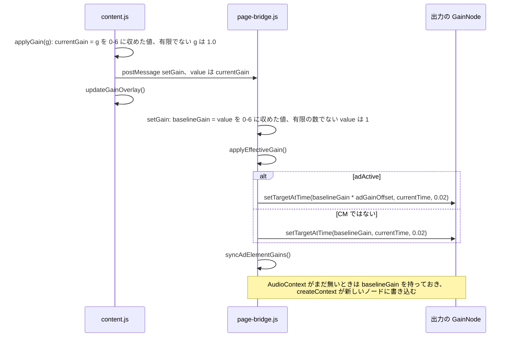

図のもと: `content.js` の `applyGain`、`updateGainOverlay`。`page-bridge.js` の `setGain`、`setAdGainOffset`、`applyEffectiveGain`、`syncAdElementGains`、`createContext`。

- bridge の `setGain` は、有限の数ならそのまま 0-6 に収めて使う。このため、ゲイン 0 (「0%」のプリセットや、スライダーを 0 にしたとき) ではノードは 0 へ動く。有限の数でない値は 1 になる。`setAdGainOffset` は `Number(value) || 1` を 0-6 に収めて使い、content はそこへ `dbToGain(currentAdGainDb)` を送る。どちらも `applyEffectiveGain` の後で `syncAdElementGains` を動かし、CM 要素のノードを新しいゲインに合わせる (「9. CM 区間」を参照)。
- オーバーレイ (`updateGainOverlay`) は、`currentGain` が 1.0 でなく、設定の `showGainOverlay` がオンで、`audioUnavailable` が false の間、プレイヤーの音量スライダーの横に `currentGain` をパーセントで出す。2000 ms ごとにも動く。ゲインは変えない。
- 計測用の枝は出力の `GainNode` より前の `sourceNode` につながっている (`buildMeasurementChain`) ので、かけたゲインは計測される音に入らない。

### チャンネルごとの値を書く単一の書き手

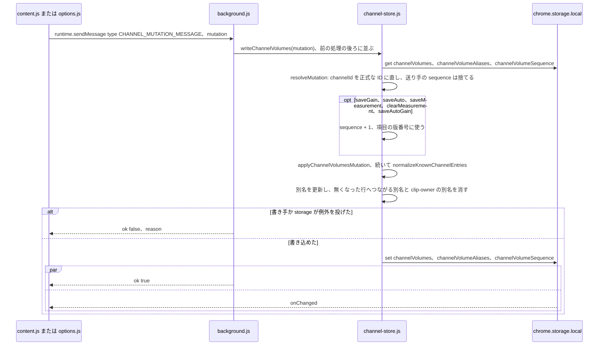

図のもと: `background.js` の `onMessage` リスナー、`namedFailure`。`channel-store.js` の `createChannelVolumesWriter`、`resolveMutation`、`mutationNeedsSequence`、`applyChannelVolumesMutation`、`normalizeKnownChannelEntries`、`aliasesLeadingTo`。`content.js` の `sendChannelMutation`。`options.js` の `mutateChannelVolumes`。

| `operation` | 送るもの | 送る項目 | 行に書くもの | 通し番号 |
|---|---|---|---|---|
| `saveGain` | content の `saveChannelGain` | `channelId`、`kind`、`gain`、`channel: { name, url }` | `gain<Kind>`、`name`、`url` | あり |
| `saveAuto` | content の `saveChannelAutoApply` | `channelId`、`kind`、`enabled`、`channel`。有限のゲインを計算できたときは `autoGain` と `reference` も | `autoApplyLoudness<Kind>`。`autoGain` があれば `autoGain<Kind>` と `autoGainRef[kind]` も | あり |
| `saveMeasurement` | content の `saveLastIntegrated` | `channelId`、`kind`、`lufs`、`reference`、0 でないときの `windows`、Auto がオンの間の `autoGain`、`channel: { name, login, url }` | `lastLufs[kind]`、`lastLufsRef[kind]`、`lastLufsWindows[kind]` (`windows` を送らなければ消す)、`lastMeasuredAt`。`autoGain` があれば `autoGain<Kind>` と `autoGainRef[kind]` も | あり |
| `clearMeasurement` | content の `clearSavedMeasurement` | `channelId`、`kind` | `lastLufs[kind]`、`lastLufsRef[kind]`、`lastLufsWindows[kind]` を消し (`lastLufs` が空になれば `lastMeasuredAt` も)、`lastLufs.<kind>` の版番号を記録する。`autoGainRef` は残す | あり |
| `saveAutoGain` | content の `saveChannelAutoGain` | `channelId`、`kind`、`autoGain`、`reference`、`channel` | `autoGain<Kind>`、`autoGainRef[kind]` | あり |
| `mergeChannelIds` | content の `migrateChannelId` | `fromId`、`toId`、`kind`、`channel` | `fromId` の行を `toId` の行へまとめ (`mergeProvisionalEntry`)、`fromId` を消す。`fromId` の行が無くても、`fromId` から `toId` への別名は保存する | なし |
| `normalizeChannels` | SW の `onInstalled`、options の `loadAll` | — | 下の整理のほかは何もしない | なし |
| `deleteChannel` | options の `removeChannel` | `channelId` | そのキーを消す。そこへつながる別名も一緒に消える | なし |
| `clearChannels` | options の `clearAll` | — | `channelVolumes` を `{}` にし、別名も空にする | なし |

- `resolveMutation` は、保存された別名をたどって `channelId` を直す。直したときは送り手が付けた `channel` の情報 (名前など) を捨て、値は正式な ID の行に入る。
- `clearChannels` 以外の操作のあとで、`normalizeKnownChannelEntries` は `login:<login>` の行を、同じ login を持つ数字の行 (1 つだけあるとき) へまとめ、その `url` を `https://www.twitch.tv/<login>` にする。`withoutClipFields` は以前の版がクリップ用に持っていた項目を落とし、値が何も残らない行は消す。`cloneEntry` は写した行の古い形の `gain` / `autoApplyLoudness` を種別ごとの項目へ広げる。`knownLoginTargets` は `login:<login>` からその数字の ID への別名を足す。操作が、別の ID へ移さずに無くした行 (消したチャンネル、クリップだけの行) は、直接またはほかの別名を経てそこへつながる別名を、すべて一緒に消す (`aliasesLeadingTo`)。
- 操作が `storage.set` まで届けば、3 つのキーを 1 回の呼び出しで書く。`normalizeChannels` や、`fromId` の行が無い `mergeChannelIds` でも書く。
- 1 つのタブの中では、content の `sendChannelMutation` が操作を `channelMutationQueue` につなげて順に送るので、SW はタブが送った順に受け取る。SW の中では `queue = task.catch(() => {})` によって、失敗した処理が次の処理を止めない。

| 答えの `reason` | 出どころ | SW のログ |
|---|---|---|
| `invalid-mutation` | 当てはめられない入力に対する `invalidChannelMutation`。たとえば、知らない操作、ユーザー ID / `login:` / `vod-owner:` のどれでもない ID、`live` / `vod` 以外の種別、0〜6 の外の `gain` / `autoGain`、真偽値でない `enabled`、有限でない `lufs`、おかしな `reference` / `windows` | `[TCV] channelVolumes mutation rejected as invalid` |
| `stored-state-invalid` | `storedStateInvalid`。別名の循環、`Number.MAX_SAFE_INTEGER` に達した通し番号 | `[TCV] channelVolumes mutation blocked by the stored state` |
| `storage-update-failed` | `reason` の付いていない失敗 (`storage.get` / `storage.set` から) | `[TCV] channelVolumes mutation failed` |

content の `sendChannelMutation` は、`ok: false` を reason をメッセージにした `Error` に変え、拡張機能の実行環境が無くなっていれば `runtime context invalid` を投げる。それぞれの呼び出し元がこのエラーをどう扱うかは、各場面に書く。SW が知らない `type` のメッセージには答えず、`[TCV] unknown message type` とログに出す。

### 設定を書く単一の書き手

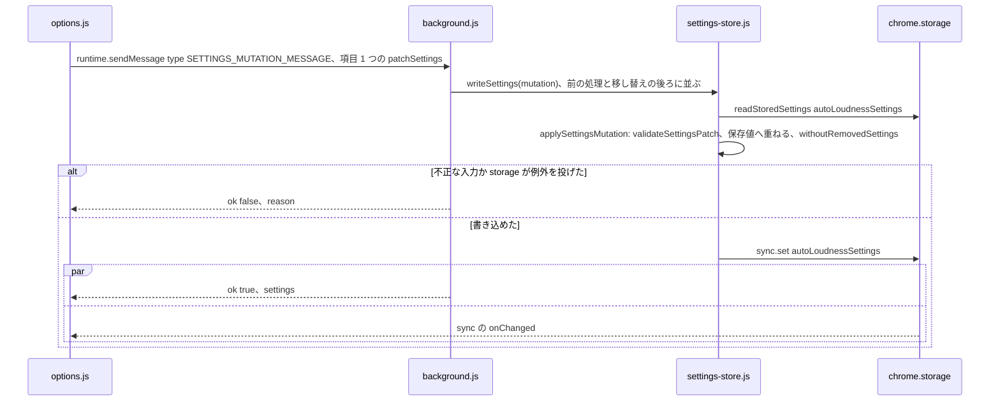

図のもと: `background.js` の `onMessage` リスナー。`settings-area.js` の `readStoredSettings`。`settings-store.js` の `createSettingsWriter`、`applySettingsMutation`、`validateSettingsPatch`、`withoutRemovedSettings`。`options.js` の `mutateSettings`。

- `validateSettingsPatch` が受け付けるのは、−30〜−6 の `targetLufs`、−24〜6 の `adGainDb`、`%` か `dB` の `displayUnit`、真偽値の `showGainOverlay` と 2 つの Auto 既定値。それ以外は `invalid-mutation` (`[TCV] settings mutation rejected as invalid`)。reason の付いていない失敗は `settings-update-failed` (`[TCV] settings mutation failed`) で答える。

## 場面ごとの流れ

### 1. Twitch のタブが起動する

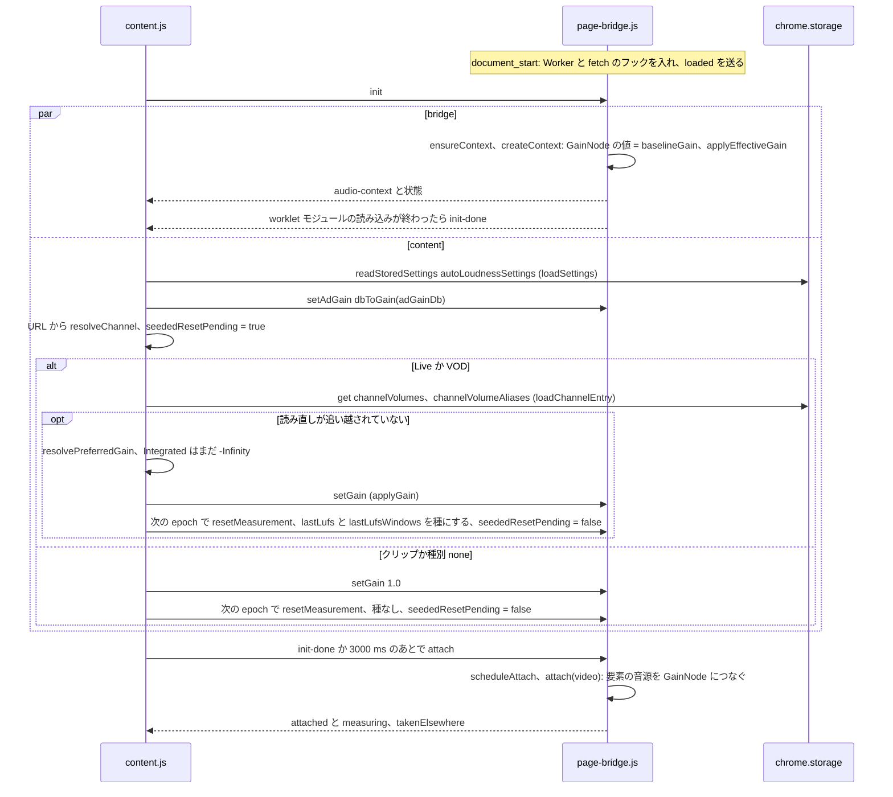

図のもと: `content.js` の末尾にある起動の処理、`injectWorklet`、`loadSettings`、`resolveChannel`、`reapplyForCurrentChannel`、`loadChannelEntry`、`sendPendingSeededReset`、`resetMeasurementForCurrentChannel`、`savedMeasurementForCurrentChannel`、`sendResetMeasurement`。`page-bridge.js` のコマンドのリスナー (`init`、`setAdGain`、`setGain`、`resetMeasurement`、`attach`)、`ensureContext`、`createContext`、`resetMeasurement`、`scheduleAttach`、`attach`。`utils.js` の `resolvePreferredGain`。

- かかるゲイン: 保存された行から決まるゲイン。まだ計測結果が届いていないので、Auto がオンなら、参照が `volume1` の保存済み `autoGain<Kind>`、手動ゲイン、1.0 のどれかになる。クリップや種別 `none` のページでは、`reapplyForCurrentChannel` は何も読まずに 1.0 をかける。
- `loadSettings` は、読み出しの間に同期された設定の変更が `onChanged` リスナーに届いていなかったときだけ、読んだ設定を取り込む (`settingsRevision`)。`setAdGain` はどちらでも送る。
- 種 (計測の初めに入れておく保存値) は、`lastLufsRef[kind]` が `volume1` で `lastLufs[kind]` が有限の数のときだけ送る。`lastLufsWindows[kind]` が正の整数ならそれも送る。bridge は種を 300 個以上 1800 個以下のゲーティング窓の重みで扱う (`MIN_SEED_WINDOWS`、`MAX_SEED_WINDOWS`)。
- 読み直しが `chrome.storage.onChanged` の始めた読み直し (場面 12) に追い越されたときは、起動からは `setGain` もリセットも送らない。追い越した読み直しが `setGain` を送り、`seededResetPending` がまだ立っているので、続けて読んだ行を種にしたリセットを送る。
- 保存: なし。このタブで最初のチャンネルごとの書き込みは、場面 5 の `saveMeasurement`。

### 2. インストール・更新と、以前の版が保存した値

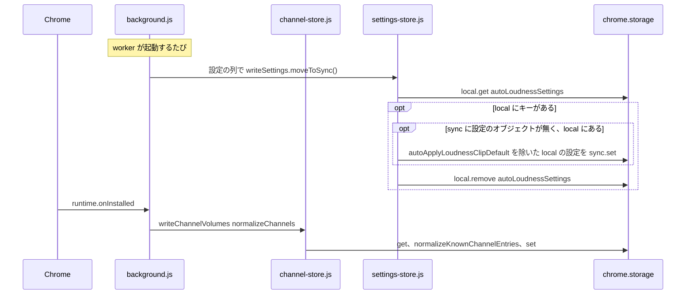

図のもと: `background.js` の最上位での `moveToSync` の呼び出しと `onInstalled` リスナー。`channel-store.js` の `normalizeKnownChannelEntries`、`withoutClipFields`、`cloneEntry`、`expandLegacyGain`、`expandLegacyAuto`。`settings-store.js` の `moveSettingsToSync`、`withoutRemovedSettings`。`settings-area.js` の `isStoredSettingsObject`。`options.js` の `loadAll`。`utils.js` の `extractGainForKind`、`resolveAutoApplySetting`。

- インストールでは設定を書かない。どちらの場所にも設定が無ければ、読むものは既定値を使う。既定値は、`targetLufs` −18、`adGainDb` −6、`displayUnit` `%`、`showGainOverlay` true、2 つの Auto 既定値は false。最初に設定を書くのは、設定ページでの操作か移し替え。
- 移し替えのときに sync にすでに設定があれば、sync をそのまま残し、local の写しを消すだけにする。local を消す前に sync へ書くので、読むものはその間ずっとどちらかを見つける。
- 設定ページを開いたときも、storage を読む前に `normalizeChannels` を送る (`loadAll`)。ここで失敗すると `[TCV] failed to normalize stored channels` とログに出し、そのまま読み込みを続ける。
- 種別ごとの項目ができる前に保存された行は、書き直さずに読む。`extractGainForKind` は `gain` を、`resolveAutoApplySetting` は `autoApplyLoudness` を代わりに読む。その行は、あとの操作が `cloneEntry` で写したときに種別ごとの項目へ広がる。
- 失敗は `[TCV] stored channel normalization failed` (やり直さない) と、`[TCV] failed to move the settings to sync` とログに出す。後者のときは、次に worker が起動して移し替えるまで設定は local に残り、読むものはそこで見つける。
- かかるゲイン: SW はタブへ何も送らない。書き込みは `onChanged` で開いているタブに届く (場面 12)。

### 3. popup で手動ゲインを設定する

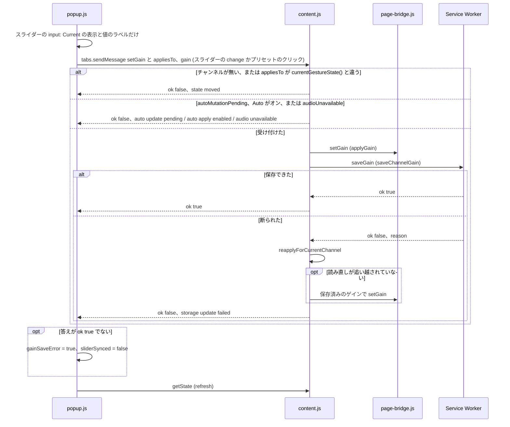

図のもと: `popup.js` の `manualSlider` の `input` / `change` / `pointerdown` / `pointerup` / `pointercancel` / `keydown` リスナー、`window` の `blur` リスナー、プリセットの `click` リスナー、`setGain`、`applyMeasured`、`syncInteractionDisabledState`、`renderState`。`content.js` の `runtime.onMessage` リスナーの `setGain`、`applyGain`、`saveChannelGain`、`reapplyForCurrentChannel`。

- `input` (スライダーを動かしている間) は Current の表示と値のラベルを変えるだけで、何も送らない。`change` で `setGain` を 1 回送る。プリセットのボタンはスライダーを動かし、同じ 2 つの表示を変えて、`setGain` を 1 回送る。これらの送信をためたりまとめたりする仕組みはほかに無い。
- スライダーは、操作を始めたとき (`pointerdown`、`keydown`、または最初の `input`) に写しておいた `appliesTo` を送る。プリセットと「チャンネルに適用」ボタンは、最後に描いた状態の `appliesTo` を送る。
- スライダーをポインターで押さえている間 (`pointerdown` から `pointerup` / `pointercancel` まで) に popup の `window` が `blur` すると、そこで操作を終える。`blur` より先に届いた `change` は `setGain` を送ってある。そのあとは次の `pointerdown` か、繰り返しでない `keydown` まで、スライダーの `input` は何もせず、`change` は離したときのものも含めて何も送らず、つまみを `blur` の時点のスライダーの値へ戻す。
- 「チャンネルに適用」(`applyMeasured`) は `resume` を送ってから、最後の `getState` から計算した Suggested のゲイン `suggestedGain(lufs.integrated, targetLufs)` で `setGain` を送る。このボタンが押せるのは、Auto がオフで、有限の Integrated があり、チャンネルがあり、音声が使えるとき。表示は「$VALUE$ をチャンネルに適用」で、$VALUE$ に表示単位でのゲインが入る。
- popup は、Auto がオン、Auto の保存待ち、`audioUnavailable` が true、または Live / VOD のチャンネルが無いページのとき、スライダーとプリセットを押せなくする。
- 書き込み: `saveGain` が正式な行の `gain<Kind>` を書く。
- 失敗: content は `[TCV] failed to save gain` を、保存しようとしたチャンネル・種別・ゲインと一緒にログに出し、行を読み直して保存済みのゲインを bridge へ戻す。`ok: true` でない答え (断られた場合も含む) では、popup は `[TCV] gain request failed` (または `[TCV] suggested gain request failed`) をログに出し、次に描くときからボタンの下に `gainSaveFailed` (「ゲインを保存できませんでした。もう一度お試しください」) を出す。さらに `sliderSynced` を消すので、次の `getState` でスライダーが今かかっているゲインに合う。

### 4. popup で LUFS 自動追従を切り替える

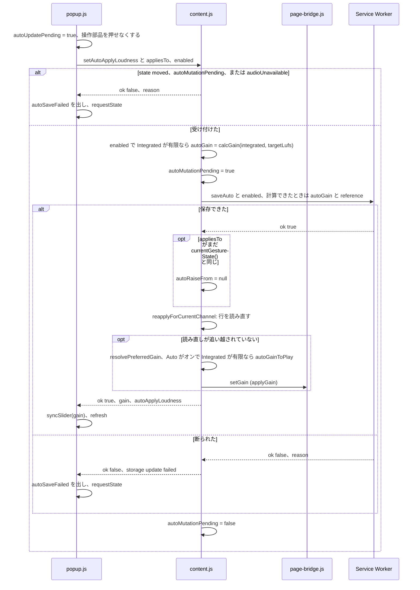

図のもと: `popup.js` の `setAutoApplyLoudness`。`content.js` の `runtime.onMessage` リスナーの `setAutoApplyLoudness`、`saveChannelAutoApply`、`reapplyForCurrentChannel`、`autoGainToPlay`。`utils.js` の `calcGain`、`resolvePreferredGain`。

- Auto をオンにすると、今の Integrated が有限の数なら、画面の状態のまま切り替えが保存されたあとで、その Integrated が求めるゲインをそのままかける (`autoRaiseFrom` を消す。場面 5)。保存されなかった切り替えは `autoRaiseFrom` をそのままにする。Integrated が有限でなければ、参照が `volume1` の保存済み `autoGain<Kind>`、手動ゲイン、1.0 のどれかをかけ、popup は「Fallback」のバッジを出す。Auto をオフにすると、手動ゲインか 1.0 をかける。
- 書き込み: `saveAuto` が `autoApplyLoudness<Kind>` を書く。ゲインを計算できたときは、`autoGain<Kind>` と `autoGainRef[kind]` = `volume1` も書く。
- `autoMutationPending` が true の間、content は `setGain` (`auto update pending`) と 2 回目の `setAutoApplyLoudness` を断る。
- 保存はできたのに、そのあとの読み直しに失敗したときは、content が新しい Auto の選択 (と計算したゲイン) を手元の行に自分で書き、`appliesTo` がまだ合っていればその行の `resolvePreferredGain` をかけて、`[TCV] Auto setting saved but local reapply failed` とログに出す。
- 失敗: content は `[TCV] failed to save Auto setting` とログに出し、ゲインはそのままにする。popup は `[TCV] Auto setting request failed` とログに出し、`autoSaveFailed` (「自動追従の設定を保存できませんでした。もう一度お試しください」) を出して、読み直した状態を描く。

### 5. 計測ブロック・自動追従・LUFS キャッシュの保存

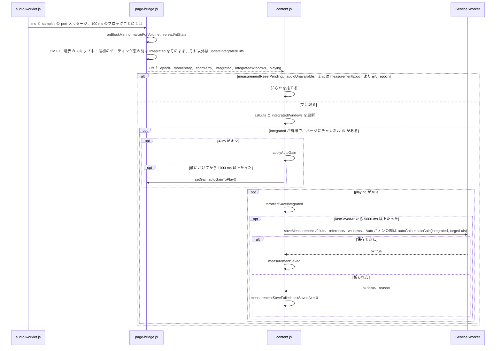

図のもと: `audio-worklet.js` の `KMeanSquareProcessor.process`。`page-bridge.js` の `onBlockMs`、`normalizeForVolume`、`updateIntegratedLufs`、`integratedLufs`、`postLufs`。`content.js` の `handleBridgeMessage` の `lufs`、`applyAutoGain`、`autoGainToPlay`、`throttledSaveIntegrated`、`saveLastIntegrated`、`measurementSaved`、`measurementSaveFailed`。

- 2 つの間引きは別々に働く。`applyAutoGain` を通るとき、Auto のもとでゲインが変わるのは 1000 ms (`DISPLAY_UPDATE_INTERVAL_MS`) に 1 回まで。`chrome.storage.onChanged` が始める読み直し (場面 10 と 12) は、この間引きを通らずに `autoGainToPlay` のゲインをかける。計測結果と今かかっている Auto のゲインを書くのは、Auto のオン・オフに関係なく、タブごとに 5000 ms に 1 回までで、`playing` が true の `lufs` からだけ。`lastSavedAt` は保存を送るときに入り、保存の失敗・SPA 遷移・測定値のリセットで 0 に戻るので、次のブロックでまた送る。`sendResetMeasurement` は `lastAutoGainUpdateAt` を `-Infinity` に、`autoRaiseFrom` を null に戻すので、リセット後に最初に届いた有限の Integrated はすぐに、そのままかかる。
- Auto がかけるゲインは `autoGainToPlay` が決める。もとは `calcGain(integrated, targetLufs)`。ブロックの short-term のラウドネスが Integrated より 6 dB (`AUTO_RISE_DB`) 以上大きいときは、Integrated が 3 dB (`AUTO_RISE_AHEAD_DB`) 大きいものとしてゲインを求める。ただし `adActive` が true の間と、最後の CM が終わってから 3 秒 (`SHORT_TERM_MS`、`adEndedAt`) の間は、そうしない。`currentGain` 以下のゲインはすぐにかかる。それより大きいゲインは、計測したレベルが最後にゲインを決めてから (`autoRaiseFrom`) 30 秒 (`AUTO_RAISE_PERIOD_MS`) ごとに 1.5 dB (`AUTO_RAISE_DB`) まで、`currentGain` から上げた値で止める。`autoRaiseFrom` が null のとき (測定値のリセット、設定の変更、保存された Auto の切り替えのあと) と、`currentGain` が 0 のときは、そのままかかる。呼ぶたびに `autoRaiseFrom` を今にする。
- `postLufs` は、つないだ要素が止まっておらずミュートでもないとき `playing` を立てる。音量 0 やゲイン 0 でも true のまま。そのため、同じチャンネル・同じ種別の 2 つのタブのうち、止まっているかミュートのタブは行に何も書かない。そのタブの Auto は自分の計測に合わせ続ける。
- 書く `autoGain` は `calcGain(integrated, targetLufs)`、つまり Integrated が求めるゲインで、`autoGainToPlay` が残したゲインではない。CM ゲインの倍率は入らない。
- CM の間、bridge はそれまでの Integrated を知らせ続けるので、Auto は CM の間も同じゲインを保つ。
- クリップや種別 `none` のページにはチャンネル ID が無いので、そこでの `lufs` は何もかけず、何も保存しない。
- 失敗: `measurementSaveFailed` は、失敗が続き始めたところで `[TCV] measurement not persisted` (info) を、それが 5000 ms (`SAVE_FAILURE_WARN_AFTER_MS`) 続いたところで `[TCV] failed to persist measurement and Auto gain` (warning) をログに出す。保存が 1 回成功すると、続いていた失敗の記録は終わる。拡張機能の実行環境が無くなったあとは何もログに出さない。

### 6. popup で測定値をリセットする

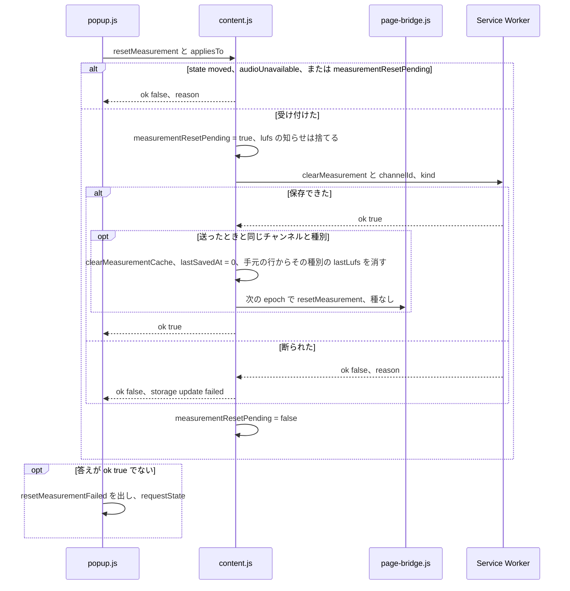

図のもと: `popup.js` の `resetMeasurement`。`content.js` の `runtime.onMessage` リスナーの `resetMeasurement`、`clearSavedMeasurement`、`clearMeasurementCache`、`sendResetMeasurement`。`page-bridge.js` の `resetMeasurement`。

- かかるゲイン: ここでは `setGain` を送らない。Auto がオンなら、次に届いた有限の Integrated が 1000 ms 待たずに、そのままかかる (場面 5)。
- 書き込み: `clearMeasurement` が `lastLufs[kind]`・`lastLufsRef[kind]`・`lastLufsWindows[kind]` を消し、消したことを通し番号つきで記録する。そのため、あとでほかの行とまとめても古い値は戻らない。保存済みの Auto のゲインは残る。
- popup の「測定値をリセット」ボタンが押せるのは、有限の Integrated か、その種別の保存値 (`hasSavedMeasurement`) があり、Auto の保存待ちやリセット待ちが無いとき。
- 失敗: content は `[TCV] failed to reset measurement` とログに出す。`ok: true` でない答え (断られた場合も含む) では、popup は `[TCV] measurement reset request failed` とログに出し、`resetMeasurementFailed` (「測定値をリセットできませんでした。もう一度お試しください」) を出す。

### 7. SPA 遷移

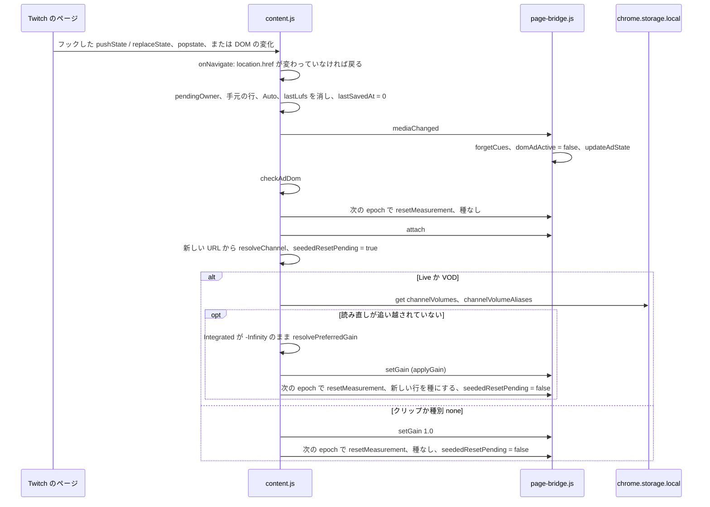

図のもと: `content.js` の `history.pushState` / `history.replaceState` の包み、`popstate` リスナー、遷移を見張る `MutationObserver`、`handleNavigation`、`onNavigate`、`checkAdDom`、`resolveChannel`、`reapplyForCurrentChannel`、`sendPendingSeededReset`、`resetMeasurementForCurrentChannel`。`page-bridge.js` の `mediaChanged` コマンド、`forgetCues`、`updateAdState`。

- `pushState` / `replaceState` の包みは、URL が変わる前に `checkAdDom` を呼び、変わったあとにマイクロタスクで `handleNavigation` を始める。
- かかるゲイン: 新しいチャンネルと種別について、計測結果なしで決まるゲイン (参照が `volume1` の保存済み Auto のゲイン、手動ゲイン、1.0 のどれか)。クリップや種別 `none` のページでは 1.0。CM 中だった場合は、bridge の `updateAdState` が CM を終わらせ、ノードは `baselineGain` へ戻る。
- 読み直しが追い越されたときは、この遷移からは `setGain` も種つきのリセットも送らない。追い越した読み直しが、あとから始まった遷移のものでも `chrome.storage.onChanged` (場面 12) が始めたものでも、自分の読み直しから両方を送るので、どちらの場合も種なしのリセットのあとに種つきのリセットが続く。
- `cross-origin` として要素を断られたクリップから離れるときは、`audioUnavailable` とその原因を消す。ほかのお知らせは遷移のあとも残す。
- 保存: なし。すでに送った `saveMeasurement` は、送ったときのチャンネル ID のまま届く。

### 8. 持ち主の ID がわかる

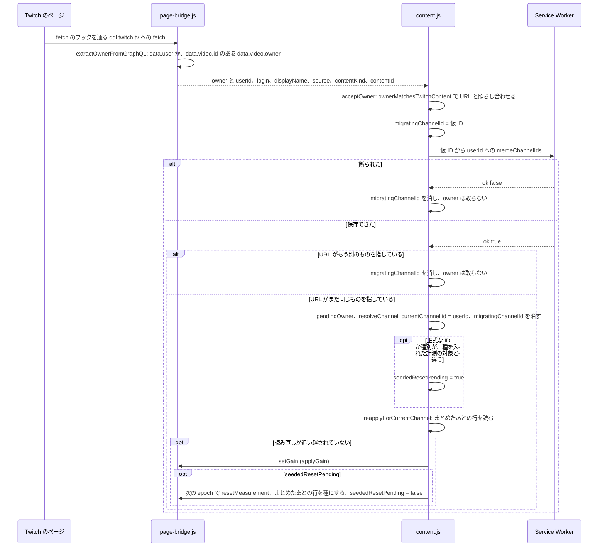

図のもと: `page-bridge.js` の `window.fetch` の包み、`extractOwnerFromGraphQL`、`postOwner`。`content.js` の `handleBridgeMessage` の `owner`、`acceptOwner`、`migrateChannelId`、`resolveChannel`、`reapplyForCurrentChannel`、`currentMeasurementTarget`、`sendPendingSeededReset`、`resetMeasurementForCurrentChannel`。`utils.js` の `ownerMatchesTwitchContent`、`provisionalChannelIdForContent`。`channel-store.js` の `mergeProvisionalEntry`、`resolveMutation`。

- bridge は、どのコンテンツのものかを応答だけから決める。`data.user` は `login` を、`data.video.owner` は `data.video.id` を `contentId` にする。`data.video.id` の無い応答の `data.video.owner` からは、owner を送らない。
- Live のページが取る owner は、`source: 'user'` で、`contentId` が URL の login のもの。VOD のページが取るのは、`source: 'video'` で、`contentId` が動画 ID のもの。クリップのページは何も取らない。`userId` は数字だけの文字列でなければならない。
- 書き込み: `mergeChannelIds`。ゲイン・Auto・Auto のゲイン・LUFS の各項目は、片方だけが持っていればその値を取り、両方が持っていれば版番号の大きい方を取る。同じ番号なら、ユーザー ID の行の値を残す。`lastLufs` では、`clearMeasurement` が記録した「消した」という状態も、持っているものとして数える。`lastLufsRef` と `lastLufsWindows` は説明している `lastLufs` の値と一緒に、`autoGainRef` は `autoGain<Kind>` と一緒に動く。`lastMeasuredAt` は 2 つのうち新しい方、`name` / `login` / `url` は owner のイベントから取る。仮 ID からユーザー ID への別名を保存する。
- `currentChannel.id` が `migratingChannelId` と同じ間、content の `onChanged` リスナーは行を読み直さない (場面 12)。そのため、まとめる書き込みそのものによって、途中で仮 ID の行のゲインがかかることはない。
- 保存された別名がすでに仮 ID をユーザー ID へ結んでいたときは、計測の対象が変わらないので、2 回目の種は送らない。
- 読み直しが `chrome.storage.onChanged` の始めた読み直し (場面 12) に追い越されたときは、`seededResetPending` がまだ立っているので、追い越した読み直しが種つきのリセットを送る。
- 失敗: `[TCV] provisional channel migration failed` (warning)。タブは仮 ID のままで、あとで届いた owner のイベントがもう一度 `acceptOwner` を動かす。

### 9. CM 区間

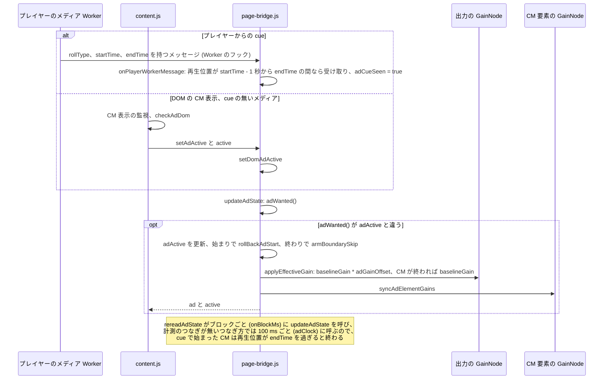

図のもと: `page-bridge.js` の `installWorkerHook`、`onPlayerWorkerMessage`、`setDomAdActive`、`adWanted`、`playerBreakActive`、`updateAdState`、`applyEffectiveGain`、`syncAdElementGains`、`attachAdElement`、`adElementGain`、`rereadAdState`、`onBlockMs`、`attach`。`content.js` の `checkAdDom`、`adIndicatorPresent`、`handleBridgeMessage` の `ad`。

- cue はプレイヤーが CM ごとに送る合図。`adWanted()` は、そのメディアで cue を 1 つでも受け取っていれば (`adCueSeen`) cue に従い、受け取っていなければ DOM の CM 表示に従う。まだ同じ CM 枠の次の広告が続くと言う cue のときは、`endTime` のあと 0.4 秒 (`AD_POD_GAP_SEC`) CM を開いたままにする。
- クライアント側の CM (つないだ要素が止まっていて、別の要素が CM を流すもの): `adActive` が true で、つないだ要素が止まっている間、`syncAdElementGains` は、再生中で、ミュートでなく、音量が 0 より大きいほかの要素を取り込み (`attachAdElement`。`ctx.state` が `running` のときだけ)、その要素のノードを `baselineGain * adGainOffset * (本編の音量 / その要素の音量)` へ動かす。それ以外のときは CM 要素のノードを 1 へ動かす。要素が DOM から外れたものはつなぎを外す。これは `updateAdState` の中、`setGain` と `setAdGainOffset` の中、そして CM 中か CM 要素のつなぎがある間の `rereadAdState` の中で動く。`rereadAdState` は計測のブロックごと (`onBlockMs`) に動き、計測のつなぎが無いつなぎ方では 100 ms ごと (`adClock`) に動く。
- content では、`ad` のイベントは `adActive` を変える。これは popup の「CM 検出中」のバッジに使い、`autoGainToPlay` が short-term のラウドネスを見ないようにする。CM が終わると `adEndedAt` を入れる (場面 5)。
- 保存: なし。CM ゲインの設定を変える話は場面 10、遷移や要素の入れ替えで CM が終わる話は場面 7 と 13。

### 10. 設定ページで設定を変える

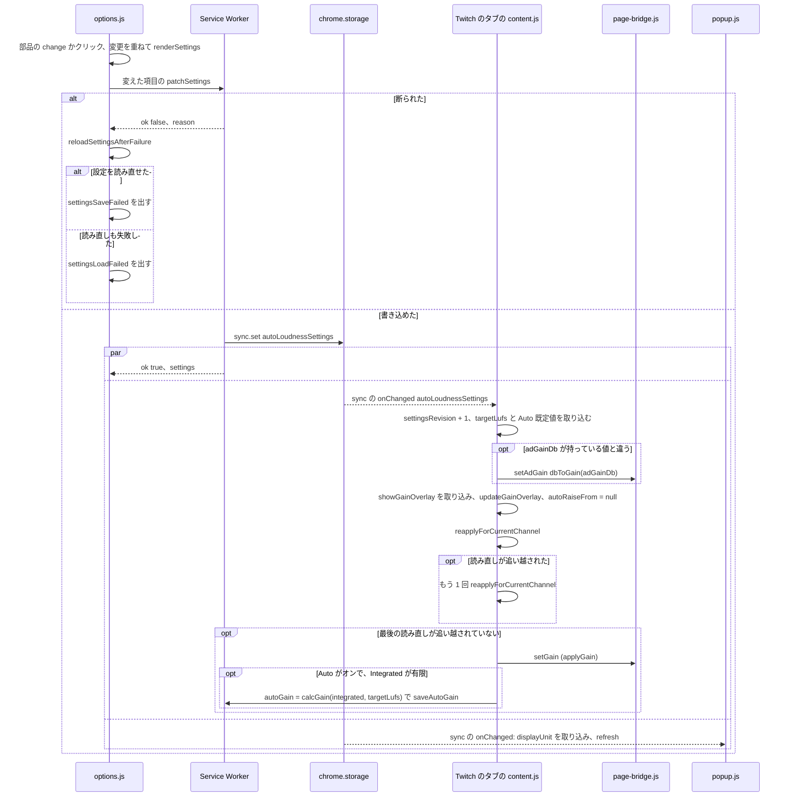

図のもと: `options.js` の `targetLufs`・`adGainDb`・2 つの Auto 既定値のトグル・`#unitToggle`・`overlayToggle` のリスナー、`updateSettings`、`mutateSettings`、`reloadSettingsAfterFailure`、`storage.onChanged` リスナー。`content.js` の `storage.onChanged` リスナー、`reapplyForCurrentChannel`、`saveChannelAutoGain`。`page-bridge.js` の `setAdGainOffset`。`popup.js` の `storage.onChanged` リスナー。

- 「Target LUFS」と「CM Gain」のスライダーは `change` で送り、`input` ではラベルを変えるだけ。Live / VOD の既定値のトグルとゲイン表示のトグルは `change` で、表示単位のボタンは `click` で送る。どれも自分が受け持つ項目 1 つだけを送る。最初の読み込みが終わるまでは押せない (`settingsReady`)。
- それぞれの Twitch のタブで: 新しい `targetLufs` は、Auto がオンで Integrated が有限ならすぐにゲインを変える (`reapplyForCurrentChannel` を通る)。新しい `adGainDb` は、CM 中ならノードを変え、CM 要素のノードも同じ手順の中で変わる (`setAdGainOffset` が `syncAdElementGains` を動かす)。新しい Auto 既定値は、その種別の Auto の選択も手動ゲインも行に無いチャンネルについて Auto を切り替えるが、`autoApplyLoudness<Kind>` は書かない。`showGainOverlay` はオーバーレイだけを変える。
- このリスナーは、`autoLoudnessSettings` が変われば、どの項目が変わったかに関係なく、行を読み直して `saveAutoGain` の条件を調べる。
- content・popup・設定ページは、`autoLoudnessSettings` を `sync` の変更からだけ取り込む。local でこのキーが変わるのは移し替えが消すときだけで、その変更は設定を運ばない。
- その読み直しが追い越されたとき (`onChanged` に届いたチャンネルの書き込みが始めた読み直し、owner のイベント、遷移による) は、それが返ったあとで、そのときのチャンネルと行についてもう 1 回読み直し、そこでかけたゲインを `saveAutoGain` で送る。もう 1 回も追い越されたときは、3 回目はしない。
- popup は `displayUnit` を取り込み、`sliderSynced` を消して、`getState` を読み直す。ほかに開いている設定ページは設定を描き直す。
- 失敗: 設定ページは保存された設定を読み直し、`settingsSaveFailed` (「設定を保存できませんでした。保存済みの値へ戻しました」) を出して、`[TCV] failed to save settings field` とログに出す。その読み直しも失敗したときは、部品は描いたままで、代わりに `settingsLoadFailed` (「保存済みの設定を読み込めませんでした。ページを再読み込みしてください」) を出し、`[TCV] failed to reload settings after save failure` もログに出す。content では、読み直しか `saveAutoGain` の失敗を `[TCV] failed to reapply or persist settings` とログに出す。

### 11. 設定ページで削除・全削除する

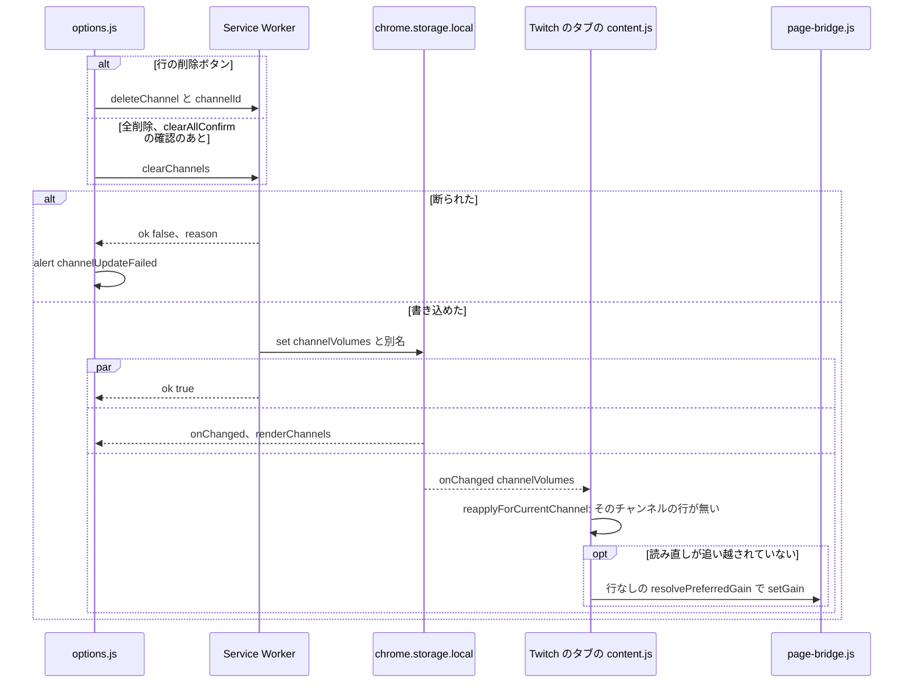

図のもと: `options.js` の `removeChannel`、`clearAll`、`mutateChannelVolumes`、`storage.onChanged` リスナー、`renderChannels`。`channel-store.js` の `deleteChannel` と `clearChannels`、`createChannelVolumesWriter`、`aliasesLeadingTo`。`content.js` の `storage.onChanged` リスナー、`reapplyForCurrentChannel`。

- 行が無いと、Auto はその種別の設定の既定値になる。ゲインは、既定値がオンで Integrated が有限なら `autoGainToPlay` のゲイン、それ以外は 1.0。
- そのチャンネルを計測し続けているタブは、次の `saveMeasurement` でそのチャンネルの行をまた書く (場面 5)。
- `deleteChannel` はキーを消し、直接またはほかの別名を経てそこへつながる別名も一緒に消す。そのため、チャンネルが呼ばれていた仮 ID は、また自分の行を作る。`clearChannels` は `channelVolumes` と別名を空にする。
- 2 つのボタンは最初の読み込みが終わるまで押せず、処理も `settingsReady` が false の間は何もせずに戻る。
- 失敗: `[TCV] failed to delete the channel` / `[TCV] failed to clear the saved channels` とログに出し、`channelUpdateFailed` (「保存済みチャンネルを更新できませんでした。もう一度お試しください」) を alert のダイアログで出す。

### 12. 書き込みがほかの画面へ届く

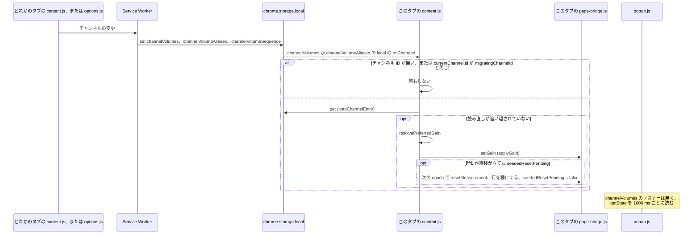

図のもと: `content.js` の `storage.onChanged` リスナー、`reapplyForCurrentChannel`、`loadChannelEntry`、`sendPendingSeededReset`。`popup.js` の `storage.onChanged` リスナーと `setInterval(refresh, DISPLAY_UPDATE_INTERVAL_MS)` の呼び出し。

- リスナーはどの行が変わったかを見ない。どのチャンネルのタブも自分の行を読み直して `setGain` を送る。値が変わるのは、決まったゲインが `currentGain` と違うときだけ。
- Auto がオンで Integrated が有限なら、この流れは `autoGainToPlay` のゲインをかけ、`applyAutoGain` の 1000 ms の間引きを通らない。
- リスナーに届いた書き込みごとに読み直しが始まり、あとの読み直しに追い越された読み直しは何もかけない。
- 保存: なし。

### 13. video 要素へのつなぎ込み

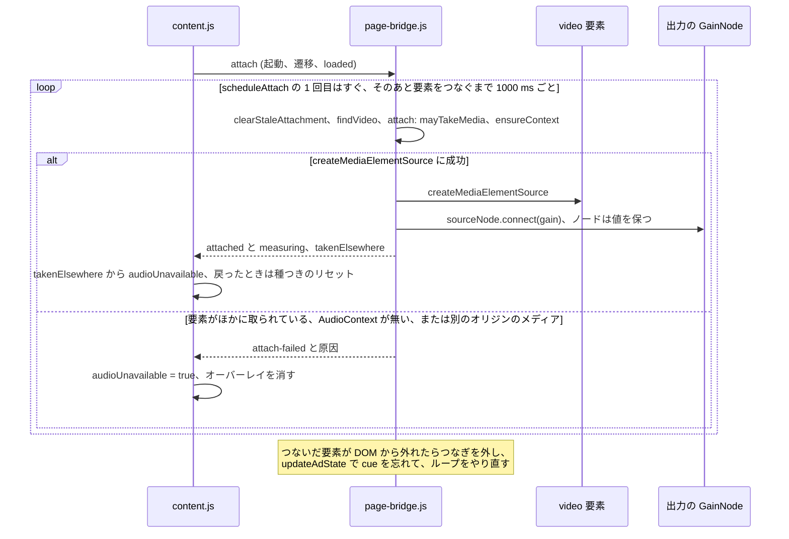

図のもと: `page-bridge.js` の `scheduleAttach`、`clearStaleAttachment`、`findVideo`、`mayTakeMedia`、`attach`、`postAttached`、`syncAttachment`。`content.js` の `handleBridgeMessage` の `attached`・`attach-failed`・`loaded`。

- かかるゲイン: ノードは持っている値を保ち、ノードにつながった要素はそのゲインで鳴る。この流れでは `setGain` を送らない。
- `audioUnavailable` が true の間: `lufs` の知らせは捨てる (Auto も `saveMeasurement` も動かない)。`setGain` / `setAutoApplyLoudness` / `resetMeasurement` は `audio unavailable` で断る。オーバーレイは消す。popup は原因ごとのお知らせ (`audioUnavailable`、`audioContextUnavailable`、`audioCrossOriginUnavailable`) を出し、操作部品を押せなくする。bridge の `baselineGain` は保つ。
- `measuring: false` の `attached` は `measurementUnavailable` を立てる。ゲインの経路は動くが、`lufs` が届かないので、計測による保存は起きない。このつなぎ方では、bridge は `adClock` を始め、計測のブロックの代わりに 100 ms ごと (`BLOCK_SEC * 1000`) に `rereadAdState` を動かす。つないだ要素が DOM から外れると、`clearStaleAttachment` がこれを止める。
- `syncAttachment` は 2000 ms ごとに動き、外れた要素を片付け、ほかに取られた要素が現れたり消えたりしたときは `attached` をもう一度送る。
- content が bridge から `loaded` を受け取ると、`audioUnavailable`・その原因・`measurementUnavailable` を消し、`init`、種つきの `resetMeasurement`、`attach` を送る。この流れでは `setGain` も `setAdGain` も送らない。
- 保存: なし。

### 14. AudioContext の停止と再開

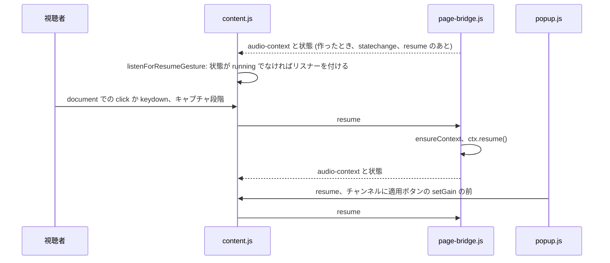

図のもと: `content.js` の `listenForResumeGesture`、`requestAudioContextResume`、`handleBridgeMessage` の `audio-context`、`runtime.onMessage` リスナーの `resume`。`page-bridge.js` の `resume` コマンド、`ensureContext`、`createContext`、`postContextState`、`attachAdElement`。`popup.js` の `applyMeasured`。

- 操作を待つリスナーは起動時に付け、知らされた状態が `running` なら外し、別の状態が知らされればまた付ける。
- 状態が変わっても、どちらの側も `baselineGain` と `adGainOffset` は変えない。`resume` (または `init` / `attach`) が AudioContext を作るときは、持っていた `baselineGain` を新しいノードに書き込み、`applyEffectiveGain` を呼ぶ。
- `attachAdElement` は `ctx.state` が `running` のときだけ CM 要素を取り込む。`attach` は状態を見ない。
- 保存: なし。

## イベントのまとめ

| イベント | かかるゲイン | チャンネルごとの保存 | 場所 |
|---|---|---|---|
| タブの起動 | 保存された行から決まるゲイン。チャンネルが無ければ 1.0 | なし | `content.js` の起動の処理、`reapplyForCurrentChannel` |
| AudioContext を作る | 新しいノードは、持っていた `baselineGain` から決まる実際のゲインで始まる | なし | `page-bridge.js` の `createContext` |
| Service Worker の起動 | SW は送らない | なし。以前の版が local に置いた設定を sync へ移す | `background.js` の `moveToSync`、`settings-store.js` の `moveSettingsToSync` |
| インストール・更新 | SW は送らない | `normalizeChannels`。設定は書かない | `background.js` の `onInstalled` |
| 設定ページを開く | options は送らない | `normalizeChannels` | `options.js` の `loadAll` |
| popup のスライダーの `input` | 変わらない、表示だけ | なし | `popup.js` の `input` リスナー |
| スライダーを押さえたまま popup が `blur` する | 変わらない。残りのドラッグは送らず、その `change` でつまみを戻す | なし | `popup.js` の `window` の `blur` リスナー |
| popup のスライダーの `change`、プリセットのクリック | 選んだゲイン | `saveGain` | `popup.js` の `setGain`、`content.js` の `setGain`、`saveChannelGain` |
| 「チャンネルに適用」 | Suggested のゲイン | `saveGain` | `popup.js` の `applyMeasured` |
| `saveGain` が断られる | 保存済みのゲインへ戻る | なし | `content.js` の `setGain`、`reapplyForCurrentChannel` |
| popup で Auto を切り替える | 決め直す | `saveAuto`、計算できたときは `autoGain` つき | `content.js` の `setAutoApplyLoudness`、`saveChannelAutoApply` |
| Auto がオンで `lufs` | `autoGainToPlay`、1000 ms に 1 回まで | `autoGain` つきの `saveMeasurement`、5000 ms に 1 回まで、`playing` が true の間 | `applyAutoGain`、`throttledSaveIntegrated` |
| Auto がオフで `lufs` | 変わらない | `saveMeasurement`、5000 ms に 1 回まで、`playing` が true の間 | `throttledSaveIntegrated` |
| `lufs` を捨てる | 変わらない | なし | `handleBridgeMessage` の `lufs` |
| 測定値のリセット | その時点では変わらない | `clearMeasurement` | `content.js` の `resetMeasurement` |
| SPA 遷移 | 新しい URL について決め直す。クリップや種別 `none` では 1.0 | なし | `onNavigate` |
| 持ち主の ID がわかる | まとめたあとの行から決め直す | `mergeChannelIds`、別名を保存 | `acceptOwner`、`migrateChannelId` |
| CM の始まり・終わり | `baselineGain * adGainOffset` と `baselineGain` の間で切り替わる | なし | `updateAdState`、`applyEffectiveGain` |
| クライアント側の CM 要素が鳴る | その要素のノードが `baselineGain * adGainOffset * (本編の音量 / その要素の音量)`、終われば 1 | なし | `syncAdElementGains` |
| 設定の項目が変わる | 決め直す。`adGainDb` が変われば CM ゲインの倍率も変える | Auto がオンで Integrated が有限なら `saveAutoGain` | `content.js` の `storage.onChanged` リスナー |
| チャンネルの削除・全削除 | 行なしで決め直す | `deleteChannel` / `clearChannels` | `options.js` の `removeChannel`、`clearAll` |
| `channelVolumes` か別名が変わる | 決め直す | なし | `content.js` の `storage.onChanged` リスナー |
| つなぎ込み・つなぎ直し | 値は保つ。要素はノードを通って鳴る | なし | `page-bridge.js` の `attach`、`clearStaleAttachment` |
| `attach-failed` | 値は保つ。要素はノードを通らない | なし、`lufs` は捨てる | `handleBridgeMessage` の `attach-failed` |
| bridge から `loaded` を受け取る | `setGain` は送らない | なし | `handleBridgeMessage` の `loaded` |
| AudioContext の停止・再開 | 値は保つ | なし | `listenForResumeGesture`、bridge の `resume` コマンド |

## 測って確かめたブラウザとサイトの挙動

ここに挙げる挙動は、コードだけでは決まらない。2026-10-25 に macOS の Chrome 156.0.8078.47 で、headless (`--headless=new`、画面を出さない Chrome) と、サインインしていない新しいプロファイルを使って測った。Chrome の項目は、このリポジトリのコードと同じ形に組んだテスト用のページと拡張機能、または項目に名前を挙げたこのリポジトリ自身のファイルで測った。Twitch の項目は、この拡張機能の写しにログ出力だけを足して測った。

- **値の変わらない書き込み** (「チャンネルごとの値を書く単一の書き手」「2. インストール・更新と、以前の版が保存した値」「12. 書き込みがほかの画面へ届く」を参照): このリポジトリの `background.js`・`channel-store.js`・`settings-store.js` を service worker で動かすと、保存済みと同じ値の `set` では、service worker・2 つの拡張機能のページ・content script のどこにも `onChanged` が届かなかった (場合ごとに 10 回中 0 回。値が変わる書き込みは 10 回中 10 回)。すでに整った状態での `normalizeChannels` でも届かなかった (10 回中 0 回)。`saveGain` は、`changes` に `channelVolumeSequence` と `channelVolumes` を載せ、変わらない `channelVolumeAliases` は載せなかった (200 回中 200 回)。
- **1 回のチャンネル書き込みの知らせと返事** (「チャンネルごとの値を書く単一の書き手」を参照): `saveGain` の書き込み 200 回中 200 回で、`onChanged` が `sendMessage` の返事より先に content script に届いた。そこの図では、この 2 つを 1 つの `par` のまとまりに描いている。返事が遅れた時間は、中央値で 0.1 ms、最大で 2.9 ms だった。
- **popup のスライダーのキーボード操作** (「3. popup で手動ゲインを設定する」を参照): `manualSlider` と同じ `min="0" max="600" step="5"` の range 入力で、値が動くキーを 1 回押すと `input` と `change` が 1 回ずつ出た (矢印キーで 5、PageUp / PageDown で 60 動く)。端でキーを押すと、どちらも出なかった。キーを押し続けると、値が動いた繰り返しごとに `change` が 1 回出た。マウスで 10 回動かすドラッグでは、`input` が 10 回、`change` が 1 回だった。`change` 1 回で `setGain` が 1 回送られ、その後に `saveGain` が続く。
- **AudioContext が止まっている間の音** (「14. AudioContext の停止と再開」を参照): テスト用のページで、ユーザーの操作より前に作った AudioContext に `createMediaElementSource` でつないだ要素を、`resume()` を呼ばずに信頼されたクリックから再生すると、タブは音を出さなかった (`audible` は 45 回の読み取り中 0 回)。AudioContext は `suspended` のままで、要素の `currentTime` も 0 のままだった。`resume()` の後は 45 回中 45 回、音が出た。Web Audio を通さない要素と、動いている AudioContext につないだ要素は、どちらも 45 回中 45 回、音が出た。この項目は `--mute-audio` を付けずに、作った音で測った。
- **拡張機能を読み込み直した後の content script** (「13. video 要素へのつなぎ込み」を参照): このリポジトリの `content_scripts` と同じ形で、`twitch.tv` の道筋に置いた仮のページを使うと、`chrome.runtime.reload()` の後、開いていたタブでは MAIN world と ISOLATED world のどちらのスクリプトも動き直さなかった (6 回中 0 回)。ページを読み込み直すと、両方が動いた (6 回中 6 回)。戻る・進むで bfcache (ページを丸ごと保存しておく仕組み) から戻した 3 回中 3 回で、どちらも動き直さなかった。拡張機能を読み込み直したときに bfcache に入っていたページは、そこから戻されずに新しく読み込まれ、両方が動いた (3 回中 3 回)。
- **つないだ要素が止まっている間の計測ブロック** (「5. 計測ブロック・自動追従・LUFS キャッシュの保存」と「9. CM 区間」を参照): クライアント側の CM が 2 つ目の `<video>` で約 30 秒流れ、つないだ要素が止まっていた Twitch の VOD では、ブロックは毎秒 10 個のまま届き続けた (まる 27 秒で 302 個、そのうち 297 個は二乗平均が 0)。このリポジトリの `audio-worklet.js` をテスト用のページで動かすと、止まった要素や終わった要素でも、二乗平均 0 のブロックが毎秒約 10 個届いた。どちらも `--mute-audio` を付けて測り、その条件でも本編の再生中のブロックは 0 ではなかった (155 回中 155 回)。
