# Gain changes and per-channel saves

> 日本語版は [gain-change-and-save.ja.md](gain-change-and-save.ja.md) を参照してください.

This document follows the code in this repository and answers two questions for each event: does the gain applied to the Twitch player change, and are per-channel values written to `chrome.storage.local`. The gain is the factor the volume is multiplied by, 1.0 (100%) leaving it as it is. Each scenario has a sequence diagram (who sends what to whom, in time order) and the functions it is drawn from. The table in [Event summary](#event-summary) puts both answers side by side. The behaviour of Chrome and Twitch that these paths depend on and the code does not decide is listed, as measured, in [Measured browser and site behaviour](#measured-browser-and-site-behaviour).

## Overview

### Participants

| Participant | File | Where it runs | What it does here |
|---|---|---|---|
| popup | `popup.js` | extension popup | Sends gestures (gain, Auto, measurement reset) to the content script of the active tab and reads `getState` every `STATE_POLL_INTERVAL_MS` (1000 ms, `pollTabState` in core/common.js). Writes nothing to storage |
| options | `options.js` | extension options page | Sends settings mutations, and channel `normalizeChannels` / `deleteChannel` / `clearChannels` mutations, to the service worker |
| content | `content.js` | Twitch tab, ISOLATED world | Chooses the baseline gain (`currentGain`), sends it to the bridge, and sends per-channel mutations to the service worker |
| bridge | `page-bridge.js` | Twitch tab, MAIN world | Owns the `AudioContext`, the output `GainNode` and the LUFS measurement, and drives the node to the effective gain |
| worklet | `audio-worklet.js` | AudioWorklet thread | Posts the K-weighted mean square (MS) of each 100 ms block |
| SW | `background.js`, `core/common.js`, `channel-store.js`, `settings-store.js` | service worker | Single writer of `channelVolumes` / `channelVolumeAliases` / `channelVolumeSequence` and of `autoLoudnessSettings`, and the move of the settings from local to sync at each start |
| storage | — | `chrome.storage.local` and `chrome.storage.sync` | Hold the keys below, the settings in sync and the rest in local. content and options listen to the `onChanged` event of both, the popup to that of sync |

### Terms

- **Content script**: a script the extension puts into the Twitch page and runs there.
- **MAIN world / ISOLATED world**: Chrome runs a content script either in the page's own JavaScript world (MAIN world, sharing `window` with the page's scripts) or in a world of its own (ISOLATED world, with the `chrome.*` extension APIs). The two exchange `window.postMessage` messages: the bridge posts events typed `__twitch_channel_volume__`, content posts commands typed `__twitch_channel_volume_cmd__`.
- **SW (service worker)**: the extension's background script, `background.js`, which loads `channel-store.js` and `settings-store.js` with `importScripts`.
- **Web Audio parts**: `AudioContext` is the whole audio-processing graph, `GainNode` the part that scales the volume. **K-weighting** is the filter that weights each frequency the way the ear hears it. **MS (mean square)** is the average of the squared signal.
- **LUFS (Loudness Units relative to Full Scale)**: the loudness unit of ITU-R BS.1770. **Integrated** is the long-term value with the quiet parts gated out, which the bridge reports and content keeps in `lastLufs.integrated`. A **gating window** is the slice Integrated is computed over. **Target LUFS** is the setting `targetLufs`, the loudness aimed at.
- **Kind**: what `classifyTwitchUrl` makes of the URL — `live` (a live stream), `vod` (VOD, video on demand: a past broadcast under `/videos/<id>`), `clip`, or `none`. Per-channel values exist for `live` and `vod`. A clip resolves to no channel.
- **Channel id**: a Twitch user id (digits), or, until the user id is known, a provisional id: `login:<login>` for Live, `vod-owner:<videoId>` for VOD. `channelVolumeAliases` maps a provisional id to the user id.
- **SPA navigation (single-page application navigation)**: Twitch moves to another URL without loading a new page.
- **Baseline gain**: the gain chosen for the current channel and kind. content holds it as `currentGain`, the bridge as `baselineGain`.
- **Ad gain offset**: `dbToGain(adGainDb)`, held by the bridge as `adGainOffset`.
- **Effective gain**: the value the output `GainNode` is driven to — `baselineGain * adGainOffset` while the bridge's `adActive` is true, `baselineGain` otherwise (`applyEffectiveGain`).
- **Auto**: the "Auto-follow LUFS" choice for one channel and kind (`autoApplyLoudnessLive` / `autoApplyLoudnessVod`), with the settings `autoApplyLoudnessLiveDefault` / `autoApplyLoudnessVodDefault` as defaults.
- **Gesture state (`appliesTo`)**: `currentGestureState()` in content, the channel id, kind and video id joined by `|`. Every `getState` answer carries it, the popup sends it back with a gesture, and content refuses the gesture with `state moved` when the value no longer matches.
- **Sequence**: the counter `channelVolumeSequence`. The channel store increments it for each value mutation and stamps it into the row's `__fieldVersions`, and when two rows are merged the field with the higher number wins.
- **Epoch**: a number content increments for each measurement reset. The bridge stamps it on the measurements it posts.

### Storage keys

| Key | Shape | Written by |
|---|---|---|
| `autoLoudnessSettings` | `{ targetLufs, adGainDb, displayUnit, showGainOverlay, autoApplyLoudnessLiveDefault, autoApplyLoudnessVodDefault }` | `settings-store.js` `createSettingsWriter` |
| `channelVolumes` | `{ [channelId]: { name, login, url, gainLive, gainVod, autoApplyLoudnessLive, autoApplyLoudnessVod, autoGainLive, autoGainVod, autoGainRef, lastLufs, lastLufsRef, lastLufsWindows, lastMeasuredAt, __fieldVersions } }`. `autoGainRef` / `lastLufs` / `lastLufsRef` / `lastLufsWindows` are `{ live, vod }` maps | `channel-store.js` `createChannelVolumesWriter` |
| `channelVolumeAliases` | `{ [provisionalId]: userId }` | `channel-store.js` `createChannelVolumesWriter` |
| `channelVolumeSequence` | integer | `channel-store.js` `createChannelVolumesWriter` |

`autoLoudnessSettings` is kept in `chrome.storage.sync`, and the other three keys in `chrome.storage.local`. Where the user has turned on Chrome sync, Chrome syncs the sync area with every Chrome the user is signed in to; where it is off, the sync area behaves like local ([`chrome.storage`](https://developer.chrome.com/docs/extensions/reference/api/storage)). A profile an earlier version wrote holds the settings in local until the SW moves them (scenario 2). Every reader of the settings, the settings writer included, goes through `readSettings` (`core/common.js`): the settings object in sync, or where sync holds none the copy in local, or `{}`, a local read that finds nothing being followed by a second read of sync.

`lastLufsRef[kind]` and `autoGainRef[kind]` hold `volume1` (`LUFS_REFERENCE_VOLUME_1`) when the value was measured with the player volume divided out. `lastLufsWindows[kind]` is the number of gating windows the stored LUFS stands on. In the tables below, `<Kind>` stands for `Live` or `Vod`.

### How the applied gain is decided

content chooses the baseline gain in `resolvePreferredGain` (`utils.js`) from the cached row of the current channel:

- Auto is decided by `resolveAutoApplySetting`: the row's `autoApplyLoudness<Kind>` where the row has it; otherwise the legacy `autoApplyLoudness`; otherwise `false` when the row has a manual gain for the kind; otherwise the settings default for the kind.
- With Auto on and a finite `lastLufs.integrated`, the gain is `calcGain(integrated, targetLufs)` = 10 ^ ((`targetLufs` − `integrated`) / 20), clamped to 0–6.
- Otherwise it is the first of these that exists: the stored `autoGain<Kind>` whose `autoGainRef[kind]` is `volume1` (with Auto on only), the stored `gain<Kind>` (or, in an entry with neither `gainLive` nor `gainVod` as a key, the legacy `gain`; read by `extractGainForKind` through `storedGain`), 1.0.

`reapplyForCurrentChannel` reads the row (`loadChannelEntry`) and then applies the gain `resolvePreferredGain` resolves, or, with Auto on and a finite Integrated value, the gain `autoGainToPlay` gives (scenario 5). When a newer read, a navigation or a channel change has started while it was reading (`preferenceRevision`, or a different `currentChannel`), it returns false and applies nothing; the diagrams below draw that as `opt the read was not overtaken`. On a page with no channel id or of kind `none` it reads nothing, applies 1.0 and returns true.

While content holds a `previewGain` for the state on screen (scenario 3; `previewHoldsGain`: the preview's `appliesTo` equals `currentGestureState()`), `reapplyForCurrentChannel` reads the row and takes its Auto choice but applies no gain, and `applyAutoGain` applies nothing, so the previewed gain keeps playing. What the same paths save is saved. Scenarios 5, 10 and 12 draw this hold; the other diagrams leave it out.

Startup, SPA navigation and an owner event that moves the measurement target (scenario 8) set `seededResetPending` before their read. While it is set, the reapply that applies its gain, whichever event started it, then sends the reset seeded from the row it read and clears the mark (`sendPendingSeededReset`).

Every path below that changes the gain ends in this common step:

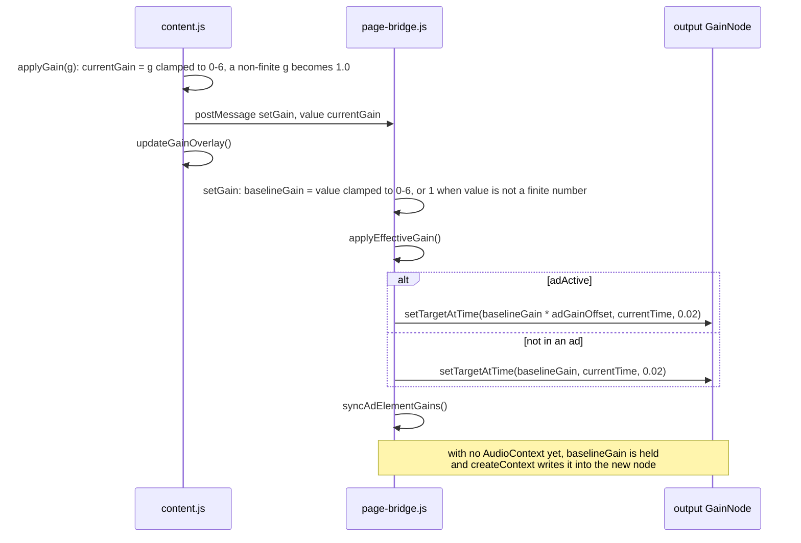

Drawn from: `content.js` `applyGain`, `updateGainOverlay`; `page-bridge.js` `setGain`, `setAdGainOffset`, `applyEffectiveGain`, `syncAdElementGains`, `createContext`.

- The bridge's `setGain` keeps a finite value, clamped to 0-6, so a gain of 0 (the "0%" preset or the slider at 0) drives the node to 0; a value that is not a finite number becomes 1. `setAdGainOffset` takes `Number(value) || 1`, clamped to 0-6; content sends it `dbToGain(currentAdGainDb)`. Both run `syncAdElementGains` after `applyEffectiveGain`, which brings the ad-element nodes to the new gain (see "9. Ad breaks").
- The overlay (`updateGainOverlay`) shows `currentGain` as a percentage next to the player's volume slider while it is not 1.0, the setting `showGainOverlay` is on and `audioUnavailable` is false. It also runs every 2000 ms. It changes no gain.
- The measurement branch is connected to `sourceNode`, ahead of the output `GainNode` (`buildMeasurementChain`), so the applied gain is not part of what is measured.

### Single writer for per-channel values

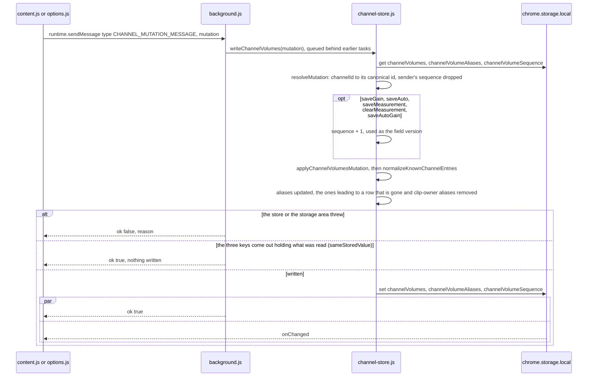

Drawn from: `background.js` `onMessage` listener; `core/common.js` `createWriteListener`; `channel-store.js` `createChannelVolumesWriter`, `sameStoredValue`, `resolveMutation`, `mutationNeedsSequence`, `applyChannelVolumesMutation`, `normalizeKnownChannelEntries`, `aliasesLeadingTo`; `content.js` `sendChannelMutation`; `options.js` `mutateChannelVolumes`.

| `operation` | Sent by | Fields sent | What it writes on the row | Sequence |
|---|---|---|---|---|
| `saveGain` | content `saveChannelGain` | `channelId`, `kind`, `gain`, `channel: { name, url }` | `gain<Kind>`, `name`, `url` | yes |
| `saveAuto` | content `saveChannelAutoApply` | `channelId`, `kind`, `enabled`, `channel`, and `autoGain` + `reference` when a finite gain was computed | `autoApplyLoudness<Kind>`; with `autoGain`: `autoGain<Kind>`, `autoGainRef[kind]` | yes |
| `saveMeasurement` | content `saveLastIntegrated` | `channelId`, `kind`, `lufs`, `reference`, `windows` when non-zero, `autoGain` while Auto is on, `channel: { name, login, url }` | `lastLufs[kind]`, `lastLufsRef[kind]`, `lastLufsWindows[kind]` (removed when no `windows` is sent), `lastMeasuredAt`; with `autoGain`: `autoGain<Kind>`, `autoGainRef[kind]` | yes |
| `clearMeasurement` | content `clearSavedMeasurement` | `channelId`, `kind` | removes `lastLufs[kind]`, `lastLufsRef[kind]`, `lastLufsWindows[kind]` (and `lastMeasuredAt` when no `lastLufs` is left) and stamps the version of `lastLufs.<kind>`; `autoGainRef` stays | yes |
| `saveAutoGain` | content `saveChannelAutoGain` | `channelId`, `kind`, `autoGain`, `reference`, `channel` | `autoGain<Kind>`, `autoGainRef[kind]` | yes |
| `mergeChannelIds` | content `migrateChannelId` | `fromId`, `toId`, `kind`, `channel` | merges the `fromId` row into the `toId` row (`mergeProvisionalEntry`) and deletes `fromId`; the alias `fromId` to `toId` is stored even when `fromId` has no row | no |
| `normalizeChannels` | SW `onInstalled`, options `loadAll` | — | nothing beyond the normalization below | no |
| `deleteChannel` | options `removeChannel` | `channelId` | deletes that key; the aliases leading to it go with it | no |
| `clearChannels` | options `clearAll` | — | `channelVolumes` becomes `{}` and the aliases are emptied | no |

- `resolveMutation` resolves `channelId` through the stored aliases. When it was resolved, the `channel` metadata the sender sent is dropped, and the value lands on the canonical row.
- After each mutation except `clearChannels`, `normalizeKnownChannelEntries` merges a `login:<login>` row into the one numeric row whose login matches and sets its `url` to `https://www.twitch.tv/<login>`, and `withoutClipFields` drops the fields an earlier version kept for clips (a row left holding no value is deleted). `cloneEntry` expands the legacy `gain` / `autoApplyLoudness` on each row it copies. `knownLoginTargets` adds the alias `login:<login>` to that numeric id. A row the mutation leaves gone without moving it onto another id (a deleted channel, a row a clip was the whole of) takes every alias that leads to it, directly or through another alias (`aliasesLeadingTo`).
- `storage.set` writes the three keys in one call. It is not called when all three come out holding the data that was read, compared field by field whatever order the keys are in (`sameStoredValue`): `normalizeChannels` on a store that is already normal, and a `mergeChannelIds` whose alias is already stored and whose rows are already merged, write nothing. A mutation that takes a sequence number changes the sequence and the row's field version, so a `saveGain` of the gain on file and a `saveMeasurement` of a level that holds are written.
- Within one tab, content's `sendChannelMutation` chains its mutations on `channelMutationQueue`, so the SW receives them in the order the tab sent them. In the SW, `queue = task.catch(() => {})` keeps a failed task from blocking the next one.

| `reason` in the answer | Raised by | SW log |
|---|---|---|
| `invalid-mutation` | `invalidChannelMutation`, for input that cannot be applied: for example an unknown operation, an id that is not a user id / `login:` / `vod-owner:` id, a kind other than `live` / `vod`, `gain` / `autoGain` outside 0–6, a non-boolean `enabled`, a non-finite `lufs`, a bad `reference` / `windows` | `[TCV] channelVolumes mutation rejected as invalid` |
| `stored-state-invalid` | `storedStateInvalid`: an alias cycle, a sequence at `Number.MAX_SAFE_INTEGER` | `[TCV] channelVolumes mutation blocked by the stored state` |
| `storage-update-failed` | a rejection without a `reason` (from `storage.get` / `storage.set`) | `[TCV] channelVolumes mutation failed` |

content's `sendChannelMutation` turns `ok: false` into an `Error` whose message is the reason, and throws `runtime context invalid` when the extension context is gone. What each caller does with the error is in its scenario. A message whose `type` the SW does not know gets no answer and is logged as `[TCV] unknown message type`.

### Single writer for settings

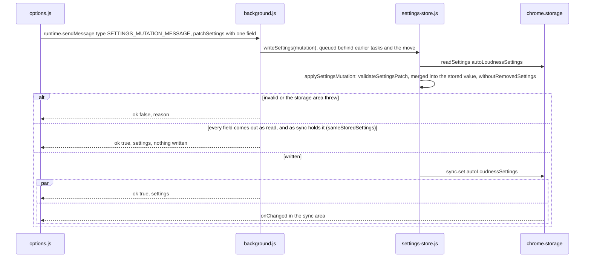

Drawn from: `background.js` `onMessage` listener; `core/common.js` `readSettings`, `writeSettingsChange`, `sameStoredSettings`, `settingCheck`; `settings-store.js` `createSettingsWriter`, `applySettingsMutation`, `validateSettingsPatch`, `withoutRemovedSettings`; `options.js` `mutateSettings`.

- `validateSettingsPatch` accepts `targetLufs` from −30 to −6, `adGainDb` from −24 to 6, `displayUnit` `%` or `dB`, and booleans for `showGainOverlay` and the two Auto defaults. Anything else is `invalid-mutation` (`[TCV] settings mutation rejected as invalid`); a rejection without a reason answers `settings-update-failed` (`[TCV] settings mutation failed`).
- A patch that leaves every field as sync holds it, the unit button already chosen among them, writes nothing. Settings read from the copy in local are written to sync, which does not hold them.

## Scenarios

### 1. A Twitch tab starts

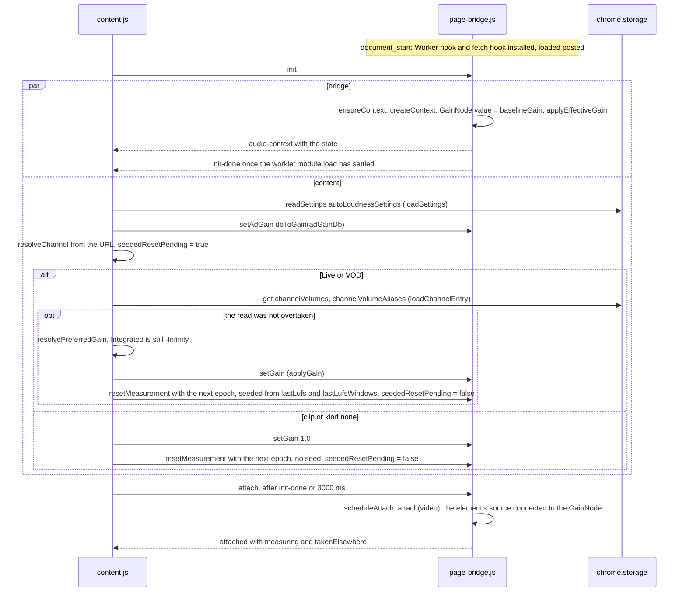

Drawn from: `content.js` the startup block at the end of the file, `injectWorklet`, `loadSettings`, `resolveChannel`, `reapplyForCurrentChannel`, `loadChannelEntry`, `sendPendingSeededReset`, `resetMeasurementForCurrentChannel`, `savedMeasurementForCurrentChannel`, `sendResetMeasurement`; `page-bridge.js` the command listener (`init`, `setAdGain`, `setGain`, `resetMeasurement`, `attach`), `ensureContext`, `createContext`, `resetMeasurement`, `scheduleAttach`, `attach`; `utils.js` `resolvePreferredGain`.

- Applied gain: the gain resolved from the stored row. With Auto on it is the stored `autoGain<Kind>` (when its reference is `volume1`) or the manual gain or 1.0, since no measurement has arrived yet. On a clip or a page of kind `none`, `reapplyForCurrentChannel` reads nothing and applies 1.0.
- `loadSettings` takes the settings it read only where no synced settings change reached the `onChanged` listener while the read was out (`settingsRevision`); it sends `setAdGain` either way.
- The seed (the stored value the measurement starts from) is sent only when `lastLufsRef[kind]` is `volume1` and `lastLufs[kind]` is finite; `lastLufsWindows[kind]` goes with it when it is a positive integer. The bridge weighs the seed as at least 300 and at most 1800 gating windows (`MIN_SEED_WINDOWS`, `MAX_SEED_WINDOWS`).
- When the read is overtaken by a reapply that `chrome.storage.onChanged` started (scenario 12), startup sends neither `setGain` nor the reset. The reapply that overtook it sends `setGain` and, since `seededResetPending` is still set, the reset seeded from the row it read.
- Saves: none. The first per-channel write of the tab is the `saveMeasurement` of scenario 5.

### 2. Install or update, and values stored by earlier versions

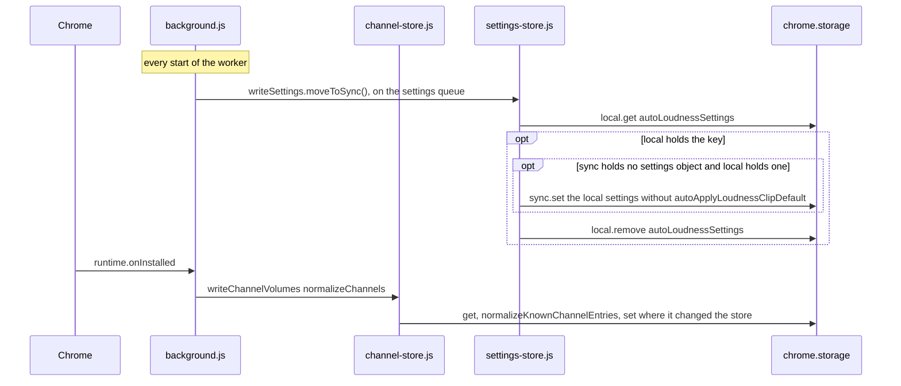

Drawn from: `background.js` the `moveToSync` call at its top level and the `onInstalled` listener; `channel-store.js` `normalizeKnownChannelEntries`, `withoutClipFields`, `cloneEntry`; `core/common.js` `expandLegacyGain`, `expandLegacyAutoFlag`; `settings-store.js` `withoutRemovedSettings`; `core/common.js` `moveSettingsToSync`, `isStoredSettingsObject`; `options.js` `loadAll`; `utils.js` `extractGainForKind`, `resolveAutoApplySetting`.

- No settings are written on install. A reader that finds settings in neither area takes the defaults: `targetLufs` −18, `adGainDb` −6, `displayUnit` `%`, `showGainOverlay` true, and false for both Auto defaults. The first settings write is a gesture on the options page or the move.
- Where sync already holds settings when the move runs, sync is kept and the local copy is only removed. Sync is written before local is removed, so a reader finds one of them throughout.
- Opening the options page sends `normalizeChannels` as well, before it reads storage (`loadAll`). A failure there is logged as `[TCV] failed to normalize stored channels` and the page goes on loading.
- A row stored before the per-kind fields is read without being rewritten: `extractGainForKind` falls back to `gain`, `resolveAutoApplySetting` to `autoApplyLoudness`. The row is expanded when a later mutation copies it through `cloneEntry`.
- Failures are logged as `[TCV] stored channel normalization failed`, which is not retried, and `[TCV] failed to move the settings to sync`, which leaves the settings in local, where the readers still find them, until the move made at the next start of the worker.
- Applied gain: the SW sends nothing to a tab. A write reaches open tabs through `onChanged` (scenario 12).

### 3. Manual gain from the popup

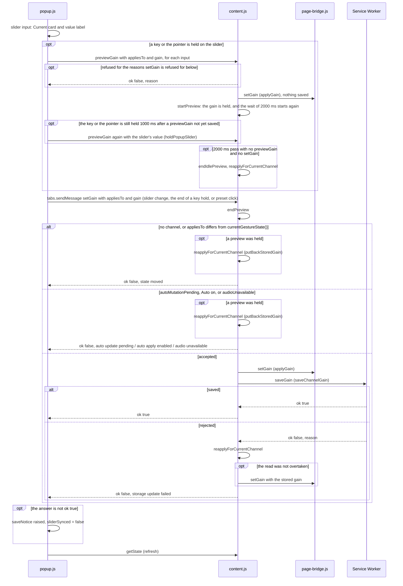

Drawn from: `popup.js` the `holdPopupSlider` call for `manualSlider`, `previewGain`, the preset `click` listener, `setGain`, `applyMeasured`, `syncInteractionDisabledState`, `renderState`; `core/common.js` `holdPopupSlider`, `PREVIEW_KEEP_ALIVE_MS`, `createSliderKeys`, `sendTabMessage`, `createSaveNotice`; `content.js` the `previewGain` and `setGain` cases of the `runtime.onMessage` listener, `startPreview`, `endPreview`, `endIdlePreview`, `putBackStoredGain`, `previewHoldsGain`, `gainGestureRefusal`, `applyGain`, `saveChannelGain`, `reapplyForCurrentChannel`.

- The gesture is `holdPopupSlider` in `core/common.js`. `input` (while the slider moves) updates the Current card and the value label and sends `previewGain`, a drag's as well as a key hold's, which content refuses where it refuses `setGain` (`gainGestureRefusal`) and otherwise applies without a save. `change` sends one `setGain`. A preset button moves the slider, updates the same two labels and sends one `setGain`.
- Only the keys that move the value hold the slider — the arrows, PageUp / PageDown, Home / End (`SLIDER_VALUE_KEYS`, `createSliderKeys`); any other key, Tab or Shift among them, takes no part. A key held on the slider, from the `keydown` of the first such key to the `keyup` of the last of them still down, is heard and not saved: each `input` sends `previewGain` as above, and the `change` each repeat fires sends nothing, a drag's during the hold included (a press of the pointer leaves the hold as it is). The `keyup`, or a `blur` of the slider or of the popup's `window` before it, sends one `setGain` with the slider's value when an `input` arrived during the hold. A `blur` during the hold also ends the gesture the way it ends a drag (below). The popup reports nothing for a `previewGain`; the `setGain` that ends the hold reports a refusal as below.
- While the key or the pointer stays held after a `previewGain` not yet saved, the popup sends it again with the slider's value every 1000 ms (`PREVIEW_KEEP_ALIVE_MS`) until the gesture ends. content holds each `previewGain` it accepts (`startPreview`): the gain a write, a settings change or a measurement would apply is not applied (see "How the applied gain is decided"). The hold lasts until the `setGain` that ends the gesture arrives (`endPreview`), or until 2000 ms (`PREVIEW_IDLE_MS`) pass after the last `previewGain`, as when the popup closes with the key down or after a drag let go of where it began (`endIdlePreview`). A preview ended that second way, and a `setGain` refused after a preview, reapply the row (`putBackStoredGain`). A preview whose `appliesTo` no longer equals `currentGestureState()` holds nothing.
- The slider sends the `appliesTo` copied when the gesture began (`pointerdown`, the `keydown` that begins a key hold, or the first `input`); a preset and the "Apply to channel" button send the `appliesTo` of the last state drawn.
- A `blur` of the popup's `window` or of the slider while the pointer is held on the slider (between its `pointerdown` and its `pointerup` / `pointercancel`) ends the gesture, a Tab that takes focus off the slider in the middle of a drag among them (Chrome goes on with the drag after it): a `change` that arrived ahead of the `blur` has sent its `setGain`, and until the next `pointerdown` or a `keydown` of a value key that is not a repeat the slider's `input` does nothing and its `change`, the one at the release included, sends nothing and puts the thumb back to the value the slider held at the `blur`. A `pointercancel` with no key held ends the gesture the same way with no `setGain` and draws nothing: content reapplies the row once the previews stop (`endIdlePreview`), and each poll draws the slider at the gain in force until the next gesture begins, which takes the slider back.
- "Apply to channel" (`applyMeasured`) sends `resume` and then `setGain` with the Suggested gain, `suggestedGain(lufs.integrated, targetLufs)` from the last `getState`. The button is enabled with Auto off, a finite Integrated value, a channel and audio available, and its label is "Apply $VALUE$ to channel" with the gain in the display unit.
- The popup disables the slider and the presets while Auto is on, an Auto save is pending, `audioUnavailable` is true, or the page has no Live / VOD channel.
- Write: `saveGain` sets `gain<Kind>` of the canonical row.
- Failure: content logs `[TCV] failed to save gain` with the channel, kind and gain it tried to save, re-reads the row and sends the stored gain back to the bridge. For any answer other than `ok: true` (a refusal included), the popup logs `[TCV] gain request failed` (or `[TCV] suggested gain request failed`), shows `gainSaveFailed` ("Could not save the gain. Please try again.") under the button from the next render on, and clears `sliderSynced` so the next `getState` moves the slider to the gain in force. The notice (`createSaveNotice` in `core/common.js`) takes only the answer to the latest save sent while the channel and kind shown now were shown, and stands until such a save is answered `ok: true` or a state names another channel or the same channel in the other kind; a state naming no channel leaves it as it is.

### 4. Auto-follow LUFS switched from the popup

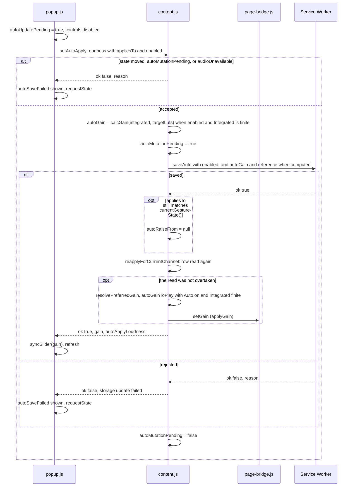

Drawn from: `popup.js` `setAutoApplyLoudness`; `content.js` the `setAutoApplyLoudness` case of the `runtime.onMessage` listener, `saveChannelAutoApply`, `reapplyForCurrentChannel`, `autoGainToPlay`; `utils.js` `calcGain`, `resolvePreferredGain`.

- Turning Auto on applies, once the toggle is saved for the state still on screen, the gain the current Integrated value asks for as it stands when the value is finite (`autoRaiseFrom` is cleared, see scenario 5); a toggle that was not saved leaves `autoRaiseFrom` as it was. Otherwise it applies the stored `autoGain<Kind>` with reference `volume1`, the manual gain or 1.0, and the popup shows the "Fallback" badge. Turning Auto off applies the manual gain or 1.0.
- Write: `saveAuto` sets `autoApplyLoudness<Kind>`, and `autoGain<Kind>` with `autoGainRef[kind]` = `volume1` when a gain was computed.
- While `autoMutationPending` is true, content refuses `setGain` (`auto update pending`) and a second `setAutoApplyLoudness`.
- When the save succeeds but the follow-up read fails, content writes the new Auto choice (and the computed gain) into its cached row itself, applies `resolvePreferredGain` of that row while `appliesTo` still matches, and logs `[TCV] Auto setting saved but local reapply failed`.
- Failure: content logs `[TCV] failed to save Auto setting` and leaves the gain as it was. The popup logs `[TCV] Auto setting request failed`, shows `autoSaveFailed` ("Could not save the Auto-follow setting. Please try again.") and draws the state it reads again.

### 5. Measurement blocks, Auto following, and the LUFS cache

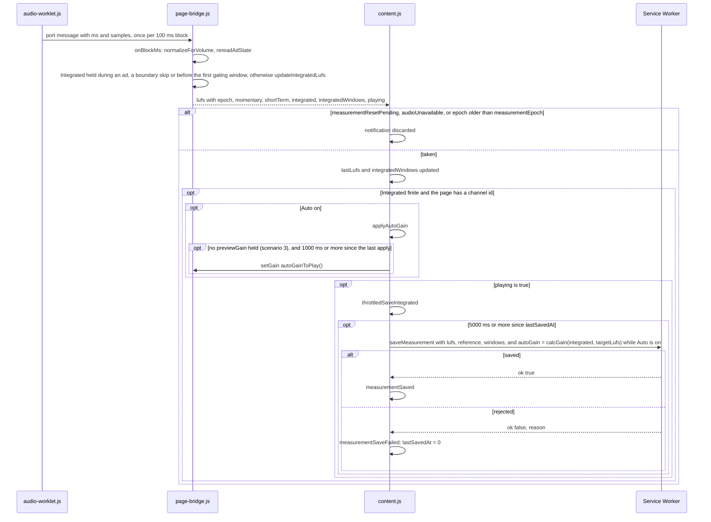

Drawn from: `audio-worklet.js` `KMeanSquareProcessor.process`; `page-bridge.js` `onBlockMs`, `normalizeForVolume`, `updateIntegratedLufs`, `integratedLufs`, `postLufs`; `content.js` the `lufs` case of `handleBridgeMessage`, `applyAutoGain`, `previewHoldsGain`, `autoGainToPlay`, `throttledSaveIntegrated`, `saveLastIntegrated`, `measurementSaved`, `measurementSaveFailed`.

- The two gates are separate. Through `applyAutoGain` the gain under Auto changes at most once per 1000 ms (`STATE_POLL_INTERVAL_MS`); the reapply that `chrome.storage.onChanged` starts (scenarios 10 and 12) applies `autoGainToPlay` without this gate. The measurement and the Auto gain in force are written at most once per 5000 ms per tab, with Auto on or off, and only from a `lufs` whose `playing` is true. `lastSavedAt` is set when a save is sent, and is put back to 0 by a failed save, by SPA navigation and by a measurement reset, so the next block sends again. `sendResetMeasurement` puts `lastAutoGainUpdateAt` back to `-Infinity` and `autoRaiseFrom` to null, so the first finite Integrated value after a reset is applied at once and as it stands.
- `autoGainToPlay` gives the gain Auto plays. It starts from `calcGain(integrated, targetLufs)`. Where the block's short-term loudness is 6 dB (`AUTO_RISE_DB`) or more over the Integrated value, it works the gain out as if the Integrated value were 3 dB (`AUTO_RISE_AHEAD_DB`) louder, except while `adActive` is true and for 3 s (`SHORT_TERM_MS`) after the last ad ended (`adEndedAt`). A gain at or below `currentGain` plays at once; one above it plays no higher than `currentGain` raised by 1.5 dB (`AUTO_RAISE_DB`) for every 30 s (`AUTO_RAISE_PERIOD_MS`) since a measured level last set the gain (`autoRaiseFrom`). Where `autoRaiseFrom` is null (after a measurement reset, a settings change or a saved Auto toggle), and where `currentGain` is 0, the gain plays as it stands. Each call sets `autoRaiseFrom` to now.
- `postLufs` sets `playing` when the attached element is neither paused nor muted. A volume of 0 or a gain of 0 leaves it true. Of two tabs on one channel and kind, a paused or muted one therefore writes nothing to the row, neither the measurement nor the Auto gain a settings change gives (scenario 10), while Auto in it goes on following its own measurement.
- The `autoGain` written is `calcGain(integrated, targetLufs)`, the gain the Integrated value asks for, not the one `autoGainToPlay` left playing; the ad offset is not part of it.
- While an ad is active the bridge reports the Integrated value it already had, so Auto keeps the same gain through the break.
- A clip or a page of kind `none` has no channel id, so `lufs` there applies nothing and saves nothing.
- Failure: `measurementSaveFailed` logs `[TCV] measurement not persisted` (info) where a stretch of failures starts and `[TCV] failed to persist measurement and Auto gain` (warning) once the stretch has lasted 5000 ms (`SAVE_FAILURE_WARN_AFTER_MS`). A save that succeeds ends the stretch. Nothing is logged once the extension context is gone.

### 6. Measurement reset from the popup

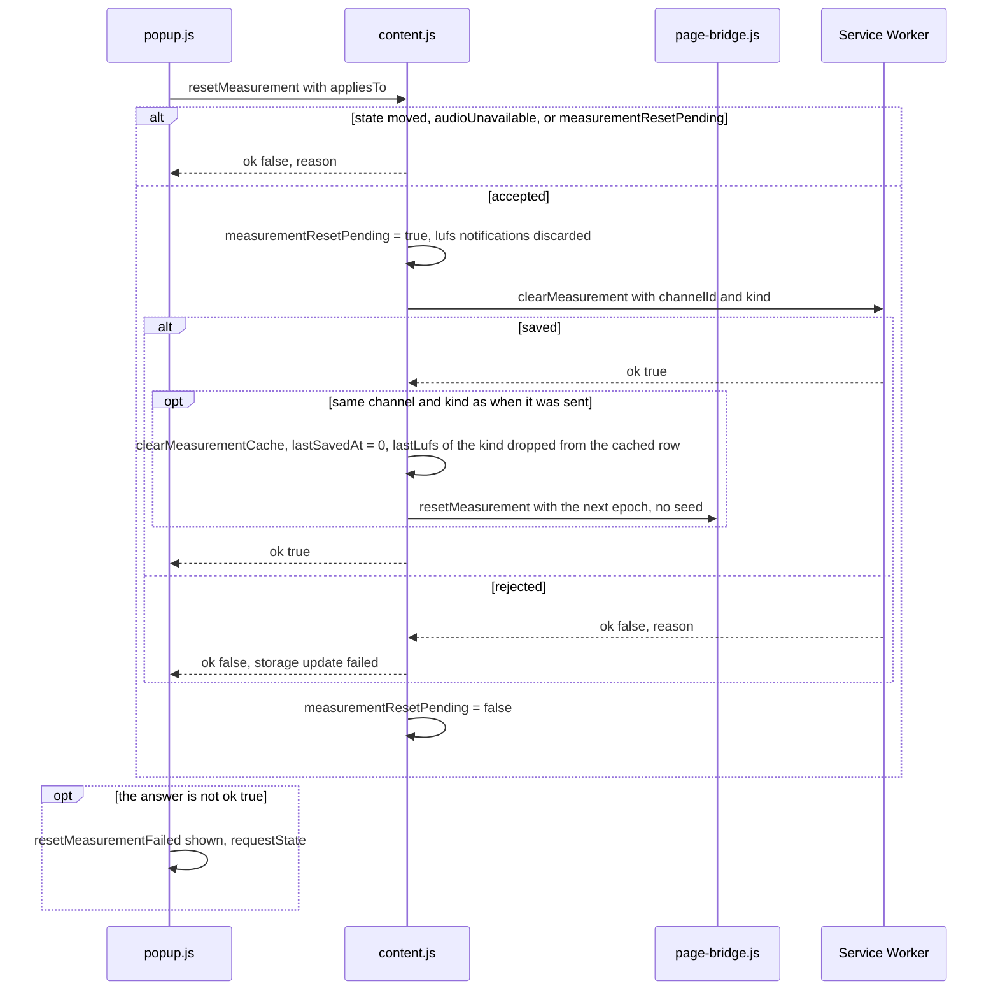

Drawn from: `popup.js` `resetMeasurement`; `content.js` the `resetMeasurement` case of the `runtime.onMessage` listener, `clearSavedMeasurement`, `clearMeasurementCache`, `sendResetMeasurement`; `page-bridge.js` `resetMeasurement`.

- Applied gain: no `setGain` is sent here. With Auto on, the next finite Integrated value is applied without the 1000 ms wait, and as it stands (scenario 5).
- Write: `clearMeasurement` removes `lastLufs[kind]`, `lastLufsRef[kind]` and `lastLufsWindows[kind]` and records the removal with a sequence number, so a later merge with another row does not bring the old value back. The stored Auto gain is kept.
- The popup's "Reset measurement" button is enabled when there is a finite Integrated value or a stored value for the kind (`hasSavedMeasurement`), and no Auto save or reset is pending.
- Failure: content logs `[TCV] failed to reset measurement`. For any answer other than `ok: true` (a refusal included), the popup logs `[TCV] measurement reset request failed` and shows `resetMeasurementFailed` ("Could not reset the measurement. Please try again.").

### 7. SPA navigation

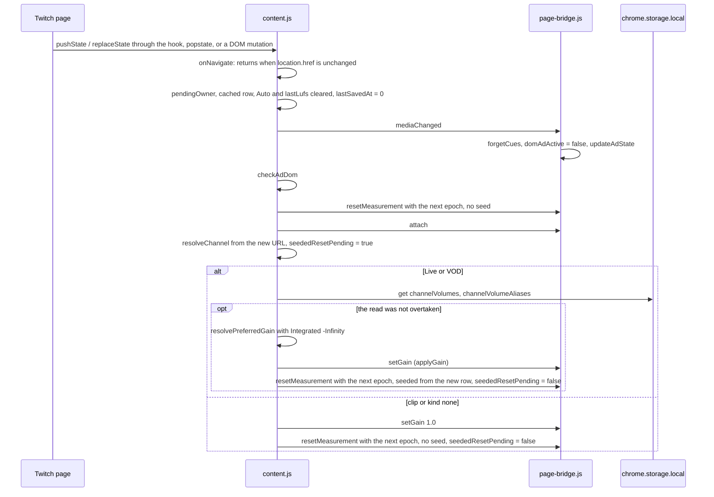

Drawn from: `content.js` the `history.pushState` / `history.replaceState` wrappers, the `popstate` listener, the navigation `MutationObserver`, `handleNavigation`, `onNavigate`, `checkAdDom`, `resolveChannel`, `reapplyForCurrentChannel`, `sendPendingSeededReset`, `resetMeasurementForCurrentChannel`; `page-bridge.js` the `mediaChanged` command, `forgetCues`, `updateAdState`.

- The `pushState` / `replaceState` wrappers call `checkAdDom` before the URL changes and start `handleNavigation` in a microtask after it.
- Applied gain: the gain resolved for the new channel and kind without a measurement (the stored Auto gain with reference `volume1`, the manual gain, or 1.0), and 1.0 on a clip or a page of kind `none`. When an ad was active, `updateAdState` in the bridge ends it and the node goes back to `baselineGain`.
- When the read is overtaken, neither `setGain` nor the seeded reset is sent from this navigation. The reapply that overtook it sends both from its own read, whether a newer navigation or `chrome.storage.onChanged` (scenario 12) started it, so the seeded reset follows the unseeded one either way.
- Leaving a clip whose element was refused as `cross-origin` clears `audioUnavailable` and its cause. Other notices are kept across the navigation.
- Saves: none. A `saveMeasurement` already sent carries the channel id it was sent with.

### 8. Owner id resolution

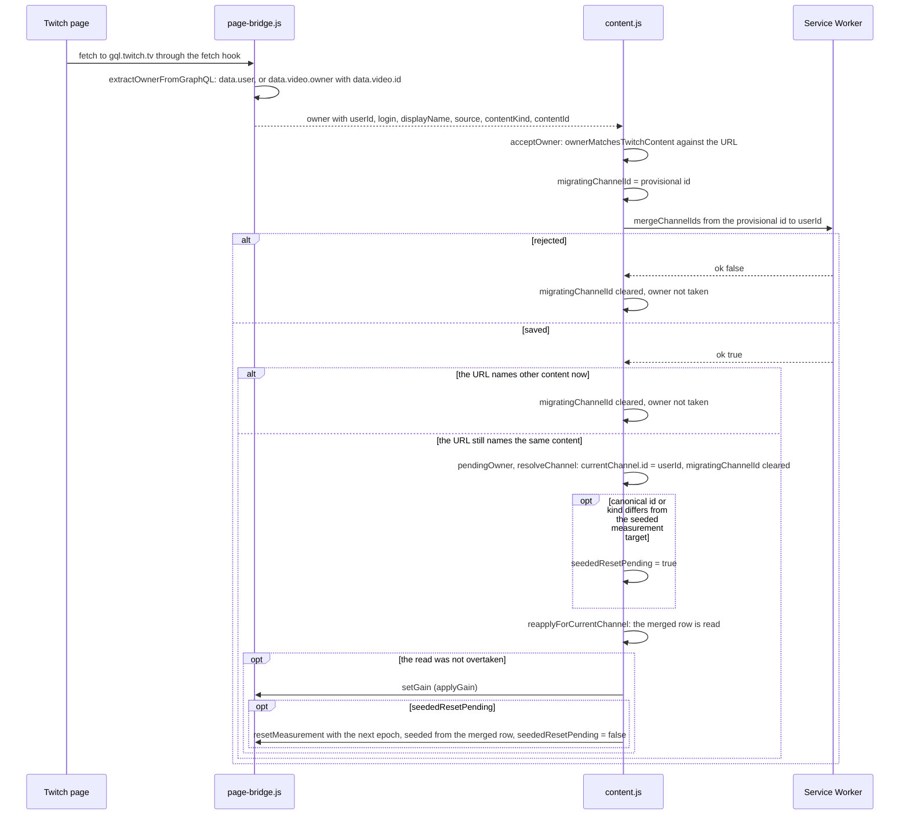

Drawn from: `page-bridge.js` the `window.fetch` wrapper, `extractOwnerFromGraphQL`, `postOwner`; `content.js` the `owner` case of `handleBridgeMessage`, `acceptOwner`, `migrateChannelId`, `resolveChannel`, `reapplyForCurrentChannel`, `currentMeasurementTarget`, `sendPendingSeededReset`, `resetMeasurementForCurrentChannel`; `utils.js` `ownerMatchesTwitchContent`, `provisionalChannelIdForContent`; `channel-store.js` `mergeProvisionalEntry`, `resolveMutation`.

- The bridge names the content from the answer alone: `data.user` with its `login` as `contentId`, and `data.video.owner` with `data.video.id`. A `data.video.owner` whose answer carries no `data.video.id` posts no owner.
- A Live page takes an owner with `source: 'user'` whose `contentId` is the login in the URL; a VOD page one with `source: 'video'` whose `contentId` is the video id. A clip page takes none. The `userId` has to be a string of digits.
- Write: `mergeChannelIds`. For each gain / Auto / Auto gain / LUFS field, a field held by one side is taken from that side, and a field held by both goes to the side with the higher field version, the user-id row keeping its value on a tie. For `lastLufs`, a removal recorded by `clearMeasurement` counts as held. `lastLufsRef` and `lastLufsWindows` go with the `lastLufs` value they describe, `autoGainRef` with `autoGain<Kind>`, `lastMeasuredAt` is the later of the two, and `name` / `login` / `url` come from the owner event. The alias from the provisional id to the user id is stored.
- While `currentChannel.id` equals `migratingChannelId`, the `onChanged` listener of content does not re-read the row (scenario 12), so the merge's own write does not apply the provisional row's gain in between.
- When the stored aliases already mapped the provisional id to the user id, the measurement target is unchanged and no second seed is sent. The `mergeChannelIds` of an owner event repeated for the same content then changes nothing in a store that is already normal, and writes nothing (see "Single writer for per-channel values").
- When the read is overtaken by a reapply that `chrome.storage.onChanged` started (scenario 12), that reapply sends the seeded reset, since `seededResetPending` is still set.
- Failure: `[TCV] provisional channel migration failed` (warning). The tab keeps the provisional id, and an owner event that arrives later runs `acceptOwner` again.

### 9. Ad breaks

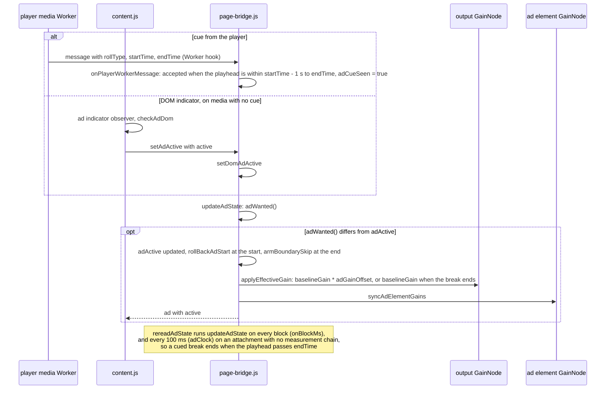

Drawn from: `page-bridge.js` `installWorkerHook`, `onPlayerWorkerMessage`, `setDomAdActive`, `adWanted`, `playerBreakActive`, `updateAdState`, `applyEffectiveGain`, `syncAdElementGains`, `attachAdElement`, `adElementGain`, `rereadAdState`, `onBlockMs`, `attach`; `content.js` `checkAdDom`, `adIndicatorPresent`, the `ad` case of `handleBridgeMessage`.

- A cue is the notice the player posts for each ad. `adWanted()` follows the cue once any cue has been accepted for the media (`adCueSeen`), and the DOM indicator otherwise. A cue that says more creatives follow in the pod keeps the break open for 0.4 s past `endTime` (`AD_POD_GAP_SEC`).
- A client-side ad (the attached element is paused and another element plays the ad): while `adActive` is true and the attached element is paused, `syncAdElementGains` takes each other element that is playing, unmuted and above volume 0 (`attachAdElement`, only while `ctx.state` is `running`) and drives its own node to `baselineGain * adGainOffset * (main volume / its volume)`. Otherwise the ad-element nodes are driven to 1. A chain whose element left the DOM is disconnected. This runs in `updateAdState`, in `setGain` and `setAdGainOffset`, and in `rereadAdState` while an ad is active or a chain exists. `rereadAdState` runs on every measurement block (`onBlockMs`) and, on an attachment with no measurement chain, every 100 ms (`adClock`).
- In content, the `ad` event sets `adActive`, which feeds the popup's "Ad detected" badge and keeps `autoGainToPlay` from looking at the short-term loudness, and its end sets `adEndedAt` (scenario 5).
- Saves: none. A change of the Ad gain setting is scenario 10; the end of a break through navigation or element replacement is in scenarios 7 and 13.

### 10. Settings changes on the options page

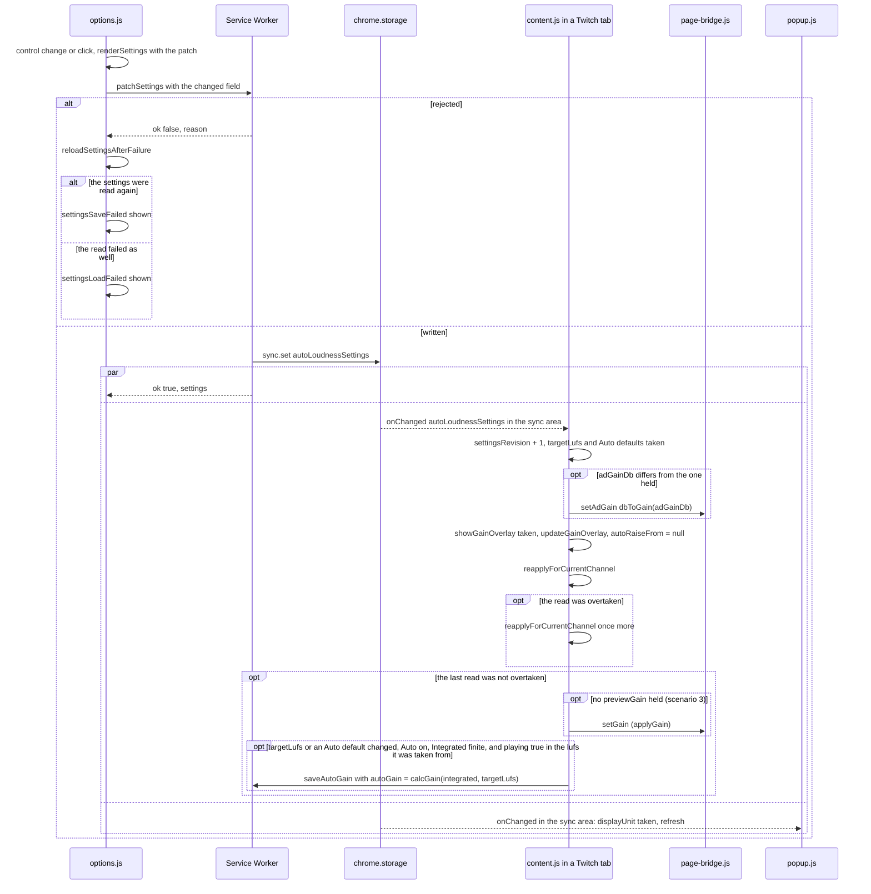

Drawn from: `core/common.js` `holdSettingsSlider` (the listeners of `targetLufs` and `adGainDb`, and the `window` `blur` listener), and its call in `options.js`, the listeners of the two default Auto toggles, `#unitToggle` and `overlayToggle`, `updateSettings`, `mutateSettings`, `reloadSettingsAfterFailure`, the `storage.onChanged` listener; `content.js` the `storage.onChanged` listener, `reapplyForCurrentChannel`, `previewHoldsGain`, `saveChannelAutoGain`; `page-bridge.js` `setAdGainOffset`; `popup.js` the `followDisplayUnit` change handler.

- The Target LUFS and Ad gain sliders send on `change`; their `input` only updates the label. While a key is held on either slider (from the `keydown` of the first value key to the `keyup` of the last of them still down; only the keys that move the value, as for the popup's slider, scenario 3), its `change` sends nothing; the `keyup`, or a `blur` of the slider or of the page's `window` before it, sends the slider's value once when it moved (a press of the pointer during the hold leaves the hold and that value as they are), and after such a `blur`, until the next `pointerdown` or a `keydown` of a value key that is not a repeat, the slider's `input` does nothing and its `change` puts the thumb back to the setting the page holds (the value written at the `blur`, or the one a refused write put back). A `blur` of the slider or of the page's `window` while the pointer is held on the slider (between its `pointerdown` and its `pointerup` / `pointercancel`) ends the gesture the same way: the `change` Chrome fires ahead of the `blur` has written the value, and until the next press the slider's `input` does nothing and its `change` puts the thumb back to the setting the page holds, which a refused write has put back to what is stored. A settings change that arrives while a key or the pointer is held on either slider (`renderSettings`, from this page's own write or a notification) takes the setting and leaves that slider and its label on the value the gesture moved to, which the gesture's end sends; a gesture that sends nothing at its end draws the setting there instead: a key that moved nothing (at the end of the range), a drag let go of on the value it began on (Chrome fires no `change` for it, whether it moved or not), and a press that a blur ends. The Live / VOD default toggles and the overlay toggle send on `change`, the unit buttons on `click`. Each sends the one field it controls, and a field sent with the value on file is not written (see "Single writer for settings"). The controls are disabled until the first load has completed (`settingsReady`).
- In each Twitch tab: a new `targetLufs` changes the gain at once under Auto with a finite Integrated value (through `reapplyForCurrentChannel`). A new `adGainDb` changes the node during an ad, and the ad-element nodes in the same step (`setAdGainOffset` runs `syncAdElementGains`). A new Auto default changes Auto for a channel whose row has neither an Auto choice nor a manual gain for the kind, without writing `autoApplyLoudness<Kind>`. `showGainOverlay` changes the overlay only.
- The listener re-reads the row and applies the gain for any change of `autoLoudnessSettings`, whichever field changed. It sends `saveAutoGain` only when `targetLufs`, `autoApplyLoudnessLiveDefault` or `autoApplyLoudnessVodDefault` differs from the value the tab held, and only from a tab whose last taken `lufs` had `playing` true (`lastLufsPlaying`, the condition `saveMeasurement` goes by, scenario 5); a change of `displayUnit`, `showGainOverlay` or `adGainDb` saves nothing, and a paused or muted tab applies the gain and saves nothing. While the tab holds a `previewGain` (scenario 3), the reapply applies no gain, and `saveAutoGain` is sent as above.
- content, the popup and the options page take `autoLoudnessSettings` from the `sync` area alone. In local the key changes only when the move removes it, and that change carries no settings.
- When that read is overtaken (by the read a channel write reaching `onChanged` starts, by an owner event or by a navigation), the listener reapplies once more after it returns, against the channel and the row as they stand then, and the gain that reapply applies is the one `saveAutoGain` carries. A reapply overtaken again is not made a third time.
- The popup takes `displayUnit`, clears `sliderSynced` and reads `getState` again. Another open options page re-renders the settings.
- Failure: the options page reads the stored settings again, shows `settingsSaveFailed` ("Could not save the setting. The saved value was restored.") and logs `[TCV] failed to save settings field`. Where that read fails as well, the controls stay as they were drawn, and the page shows `settingsLoadFailed` ("Could not load the saved settings. Please reload the page.") instead and also logs `[TCV] failed to reload settings after save failure`. In content, a failure of the read or of `saveAutoGain` is logged as `[TCV] failed to reapply or persist settings`.

### 11. Delete and clear all on the options page

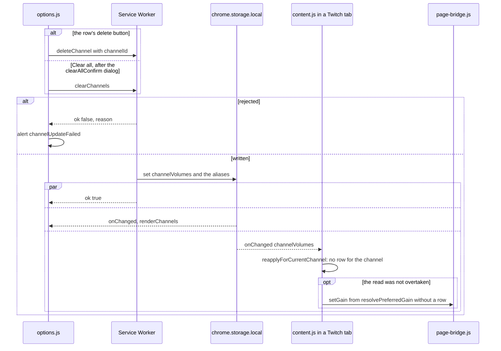

Drawn from: `options.js` `removeChannel`, `clearAll`, `mutateChannelVolumes`, the `storage.onChanged` listener, `renderChannels`; `channel-store.js` the `deleteChannel` and `clearChannels` cases, `createChannelVolumesWriter`, `aliasesLeadingTo`; `content.js` the `storage.onChanged` listener, `reapplyForCurrentChannel`.

- Without a row, Auto is the settings default for the kind. The gain is the one `autoGainToPlay` gives when that default is on and the Integrated value is finite, and 1.0 otherwise.
- A tab that keeps measuring the channel writes a row for it again with its next `saveMeasurement` (scenario 5).
- `deleteChannel` removes the key, and every alias that leads to it, directly or through another alias, goes with it, so a provisional id the channel was known by makes a row of its own again. `clearChannels` empties `channelVolumes` and the aliases.
- Both buttons are disabled until the first load has completed, and the handlers return while `settingsReady` is false.
- Failure: `[TCV] failed to delete the channel` / `[TCV] failed to clear the saved channels`, and an alert with `channelUpdateFailed` ("Could not update saved channels. Please try again.").

### 12. Writes reaching other contexts

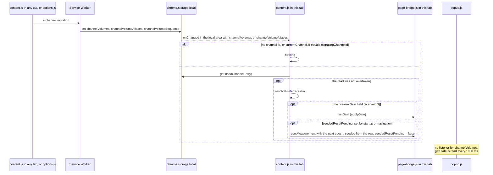

Drawn from: `content.js` the `storage.onChanged` listener, `reapplyForCurrentChannel`, `loadChannelEntry`, `previewHoldsGain`, `sendPendingSeededReset`; `popup.js` the `followDisplayUnit` change handler and the `pollTabState(refresh)` call.

- The listener does not look at which row changed: a tab on any channel re-reads its own row and sends `setGain`. The value changes where the resolved gain differs from `currentGain`. A tab that holds a `previewGain` (scenario 3) sends none, and puts back the gain storage holds when the preview ends with no save or a refused one.
- With Auto on and a finite Integrated value, this path applies the gain `autoGainToPlay` gives and does not go through the 1000 ms gate of `applyAutoGain`.
- Each write that reaches the listener starts its own read, and a read overtaken by a later one applies nothing.
- Saves: none.

### 13. Attaching to the video element

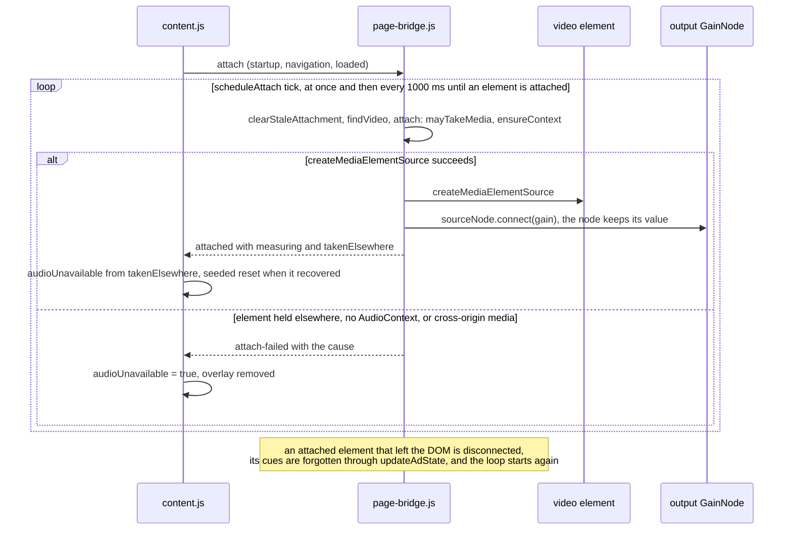

Drawn from: `page-bridge.js` `scheduleAttach`, `clearStaleAttachment`, `findVideo`, `mayTakeMedia`, `attach`, `postAttached`, `syncAttachment`; `content.js` the `attached`, `attach-failed` and `loaded` cases of `handleBridgeMessage`.

- Applied gain: the node keeps the value it holds, and an element connected to it plays at that gain. No `setGain` is sent on this path.
- While `audioUnavailable` is true: `lufs` notifications are discarded (no Auto, no `saveMeasurement`), `setGain` / `setAutoApplyLoudness` / `resetMeasurement` are refused with `audio unavailable`, the overlay is removed, and the popup shows the notice for the cause (`audioUnavailable`, `audioContextUnavailable` or `audioCrossOriginUnavailable`) and disables its controls. The bridge's `baselineGain` is kept.
- `attached` with `measuring: false` sets `measurementUnavailable`: the gain path works and no `lufs` arrives, so nothing is saved by measurement. On such an attachment the bridge starts `adClock`, which runs `rereadAdState` every 100 ms (`BLOCK_SEC * 1000`) in place of the measurement blocks; `clearStaleAttachment` stops it when the attached element leaves the DOM.
- `syncAttachment` runs every 2000 ms: it clears a detached element and posts `attached` again when a held element appears or leaves.
- When content receives `loaded` from the bridge, it clears `audioUnavailable`, its cause and `measurementUnavailable`, and sends `init`, a seeded `resetMeasurement` and `attach`. It sends no `setGain` or `setAdGain` on this path.
- Saves: none.

### 14. AudioContext suspended and resumed

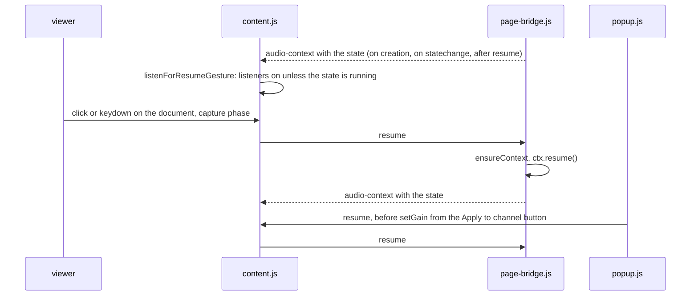

Drawn from: `content.js` `listenForResumeGesture`, `requestAudioContextResume`, the `audio-context` case of `handleBridgeMessage`, the `resume` case of the `runtime.onMessage` listener; `page-bridge.js` the `resume` command, `ensureContext`, `createContext`, `postContextState`, `attachAdElement`; `popup.js` `applyMeasured`.

- The gesture listeners are added at startup, removed when the reported state is `running`, and added again when another state is reported.
- Neither side changes `baselineGain` or `adGainOffset` on a state change. A `resume` (or `init` / `attach`) that builds the context writes the held `baselineGain` into the new node and calls `applyEffectiveGain`.
- `attachAdElement` takes an ad element only while `ctx.state` is `running`; `attach` does not look at the state.
- Saves: none.

## Event summary

| Event | Applied gain | Per-channel save | Where |
|---|---|---|---|
| Tab startup | Set to the gain resolved from the stored row, 1.0 without a channel | none | `content.js` startup block, `reapplyForCurrentChannel` |
| AudioContext built | The new node starts at the effective gain of the held `baselineGain` | none | `page-bridge.js` `createContext` |
| Service worker start | Not sent by the SW | none; the settings an earlier version kept in local are moved to sync | `background.js` `moveToSync`, `core/common.js` `moveSettingsToSync` |
| Install or update | Not sent by the SW | `normalizeChannels`, written only where it changes the store; no settings are written | `background.js` `onInstalled` |
| Options page opened | Not sent by options | `normalizeChannels`, written only where it changes the store | `options.js` `loadAll` |
| Popup slider `input` | Unchanged, labels only | none | `popup.js` `input` listener |
| Popup or slider `blur` while the slider is held | Unchanged; the rest of the drag is not sent, and its `change` puts the thumb back | none | `popup.js` `manualSlider` and `window` `blur` listeners |
| Popup slider `change`, preset click | Set to the chosen gain | `saveGain` | `popup.js` `setGain`, `content.js` `setGain` case, `saveChannelGain` |
| Key held on the popup slider, or a drag on it | Set to each value it moves to (`previewGain`), which writes, settings changes and Auto do not replace until the gesture ends (scenario 3) | `saveGain` once, at the `keyup` or a `blur` for a key hold, at the `change` for a drag | `core/common.js` `holdPopupSlider`, `content.js` `previewGain` case, `startPreview`, `endIdlePreview` |
| "Apply to channel" | Set to the Suggested gain | `saveGain` | `popup.js` `applyMeasured` |
| `saveGain` rejected | Back to the stored gain | none | `content.js` `setGain` case, `reapplyForCurrentChannel` |
| Auto switched in the popup | Resolved again | `saveAuto`, with `autoGain` when computed | `content.js` `setAutoApplyLoudness` case, `saveChannelAutoApply` |
| `lufs` with Auto on | `autoGainToPlay`, at most once per 1000 ms | `saveMeasurement` with `autoGain`, at most once per 5000 ms, while `playing` is true | `applyAutoGain`, `throttledSaveIntegrated` |
| `lufs` with Auto off | Unchanged | `saveMeasurement`, at most once per 5000 ms, while `playing` is true | `throttledSaveIntegrated` |
| `lufs` discarded | Unchanged | none | `lufs` case of `handleBridgeMessage` |
| Measurement reset | Unchanged at that moment | `clearMeasurement` | `content.js` `resetMeasurement` case |
| SPA navigation | Resolved for the new URL, 1.0 on a clip or kind `none` | none | `onNavigate` |
| Owner id arrives | Resolved from the merged row | `mergeChannelIds`, alias stored | `acceptOwner`, `migrateChannelId` |
| Ad starts or ends | Switches between `baselineGain * adGainOffset` and `baselineGain` | none | `updateAdState`, `applyEffectiveGain` |
| Client-side ad element plays | Its own node at `baselineGain * adGainOffset * (main volume / its volume)`, 1 afterwards | none | `syncAdElementGains` |
| Settings field changed | Resolved again, and the ad offset updated when `adGainDb` changed | `saveAutoGain` when `targetLufs` or an Auto default changed, Auto is on, Integrated is finite and the last `lufs` had `playing` true | `content.js` `storage.onChanged` listener |
| Channel deleted or all cleared | Resolved without the row | `deleteChannel` / `clearChannels` | `options.js` `removeChannel`, `clearAll` |
| `channelVolumes` or aliases changed | Resolved again | none | `content.js` `storage.onChanged` listener |
| Attach or re-attach | Value kept, the element plays through the node | none | `page-bridge.js` `attach`, `clearStaleAttachment` |
| `attach-failed` | Value kept, the element does not play through the node | none, `lufs` discarded | `attach-failed` case of `handleBridgeMessage` |
| `loaded` received from the bridge | No `setGain` sent | none | `loaded` case of `handleBridgeMessage` |
| AudioContext suspended or resumed | Value kept | none | `listenForResumeGesture`, the bridge's `resume` command |

## Measured browser and site behaviour

The code does not decide the behaviour below. It was measured on 2026-10-25 with Chrome 156.0.8078.47 on macOS, headless (`--headless=new`), in new profiles that were not signed in. The Chrome items ran test pages and probe extensions built in the shape of this repository's code, or this repository's own files where the item names them. The Twitch item ran a copy of this extension with logging added and no other change.

- **A write of unchanged values** (see "Single writer for per-channel values", "2. Install or update, and values stored by earlier versions" and "12. Writes reaching other contexts"): with this repository's `background.js`, `channel-store.js` and `settings-store.js` in the service worker, a `set` of values equal to the stored ones fired no `onChanged` in the service worker, in two extension pages or in a content script (0 of 10 per case, where a write that changed a value fired 10 of 10). `normalizeChannels` on a store that was already normal fired none (0 of 10). A `saveGain` listed `channelVolumeSequence` and `channelVolumes` in `changes`, and not the unchanged `channelVolumeAliases` (200 of 200).
- **The change notice and the answer of one channel write** (see "Single writer for per-channel values"): `onChanged` reached the content script before the answer to its `sendMessage` in 200 of 200 `saveGain` writes, the two the diagram there draws in one `par` block. The answer came 0.1 ms later at the median and 2.9 ms later at most.
- **Keyboard on the popup slider** (see "3. Manual gain from the popup"): on a range input with `manualSlider`'s `min="0" max="600" step="5"`, a key press that moved the value fired one `input` and one `change` (an arrow key moves 5, PageUp / PageDown 60), and a press at either end fired neither. A held key fired one `change` for each repeat that moved the value. A mouse drag with 10 moves fired 10 `input` and 1 `change`. The `change` of a drag sends one `setGain`, and its `saveGain` follows; a held key sends `previewGain` for each `input` and one `setGain` where it is let go.
- **The settings page's sliders** (see "10. Settings changes on the options page"): measured on 2026-10-30 with Chrome 156.0.8078.76, sending CDP input (`Input.dispatchKeyEvent`, `Input.dispatchMouseEvent`) to this repository's options page. Headless, a key held on the Ad gain slider (a press and 10 repeats, each moving the value) fired one `change` for each of the 11. Headed, a drag on either slider during which the window lost focus fired its `input`s, then `change` at the value then, then the slider's `blur` and the window's `blur`; no `input` came after the blur and no `change` at the release, whether focus stayed away or came back (one run of each for each slider). A real mouse held through an application switch was not driven.
- **A Tab in the middle of a drag** (see "3. Manual gain from the popup"): measured on 2026-10-30 with Chrome 156.0.8078.76, headless, with CDP mouse and key input (`Input.dispatchMouseEvent`, `Input.dispatchKeyEvent`), on a range input (`min="-30" max="-6" step="1"`) on an extension settings page. A Tab pressed while the pointer dragged the slider fired `keydown`, then `change` at the value then, then the slider's `blur` (focus moved to a button), then the Tab's `keyup`. The drag went on: three `input`s followed the `blur`, and the release fired a second `change` at the value the pointer had reached. This repository's pages, a real mouse and a real Tab key were not used.
- **Audio while the AudioContext is suspended** (see "14. AudioContext suspended and resumed"): in a test page, an element routed through `createMediaElementSource` into a context created before any user activation, then played from a trusted click without `resume()`, left the tab silent (`audible` in 0 of 45 samples); the context stayed `suspended` and the element's `currentTime` stayed at 0. After `resume()` the tab was audible in 45 of 45. The element without Web Audio, and the element routed into a running context, were audible in 45 of 45 each. This item ran without `--mute-audio`, with a generated tone.
- **Content scripts after an extension reload** (see "13. Attaching to the video element"): with this repository's `content_scripts` shape and a stub page served at a `twitch.tv` path, `chrome.runtime.reload()` re-ran neither the MAIN-world nor the ISOLATED-world script in the tab that was open (0 of 6), and reloading the page ran both (6 of 6). In 3 of 3 back/forward restores from bfcache neither script ran again. A page that was in bfcache when the extension reloaded was not restored from it and loaded afresh, running both (3 of 3).
- **Measurement blocks while the attached element is paused** (see "5. Measurement blocks, Auto following, and the LUFS cache" and "9. Ad breaks"): on a Twitch VOD whose client-side ad played in a second `<video>` for about 30 s while the attached element was paused, blocks kept arriving at 10 per second (302 blocks over 27 whole seconds, 297 of them with a mean square of 0). With this repository's `audio-worklet.js` in a test page, a paused or ended element gave about 10 blocks per second with a mean square of 0. Both ran with `--mute-audio`, under which the blocks taken during content playback were non-zero (155 of 155).
